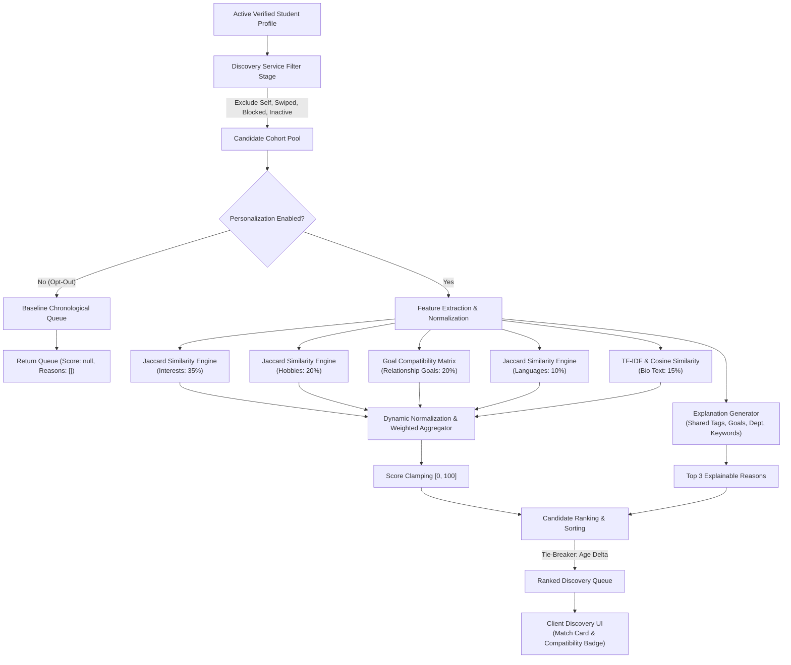
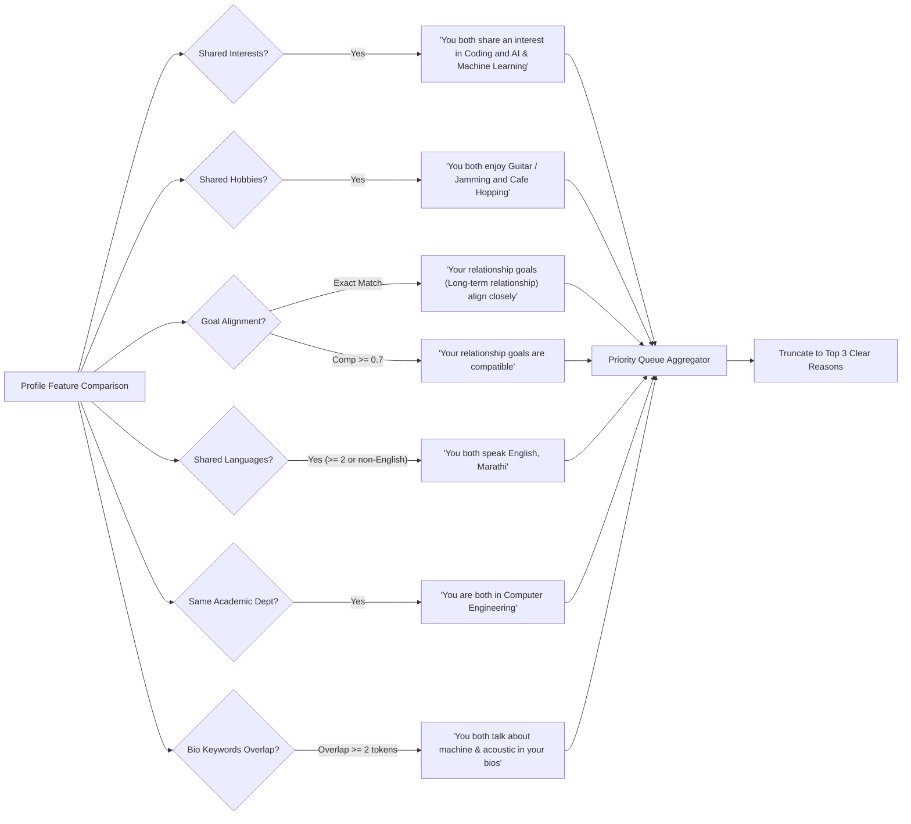
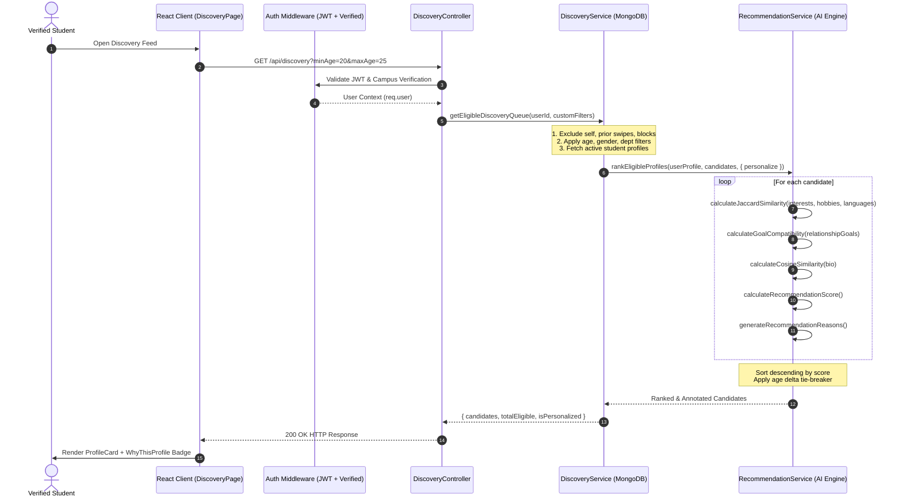

# WeDate AI Recommendation Engine

A comprehensive technical specification of the content-based recommendation system powering **Smart Discovery** in WeDate — an AI-powered dating web application designed exclusively for verified student communities.

---

## 1. System Overview & Philosophy

The WeDate AI Recommendation Engine is engineered to solve the cold-start and black-box problems common in contemporary dating platforms. Traditional collaborative filtering systems suffer from data sparsity in early deployment and opaque algorithmic manipulation. In contrast, WeDate implements an **in-process, content-based recommendation pipeline** built on deterministic similarity metrics, explicit relationship affinity mappings, and transparent rationale generation.

### Core Architectural Principles

- **Zero External AI Dependencies**: Runs locally within the Node.js/Express application runtime using native mathematical vector and set operations. No third-party LLM or vector database API latency or recurring costs.
- **Privacy-Preserving & On-Device Computations**: User profile vectors are dynamically processed in-memory upon discovery feed retrieval without sending student personal data to third-party endpoints.
- **Explainable by Design**: Every candidate presented in the discovery queue includes up to three human-readable compatibility reasons explaining *why* they were recommended.
- **Dynamically Normalized Scoring**: Gracefully adapts to incomplete profiles by dynamically redistributing weights among available profile components rather than penalizing missing non-mandatory fields.
- **User Agency & Opt-Out Support**: Fully supports algorithmic opt-out through privacy settings, allowing users to toggle between personalized smart ranking and chronological baseline queues.

---

## 2. End-to-End Pipeline Architecture

The recommendation engine operates as a pipeline during discovery queue generation. When an authenticated, verified student requests their discovery queue, candidate profiles undergo multi-stage filtering, feature extraction, similarity scoring, tie-breaking, and explanation synthesis.



---

## 3. Algorithm Components & Mathematical Formulations

The engine decomposes user profiles into five orthogonal feature spaces, computes component similarity scores $\text{sim}_i \in [0.0, 1.0]$, and applies dynamic normalization.

```
+-----------------------------------------------------------------------------+
|                     WeDate Profile Similarity Breakdown                     |
+-----------------------------------------------------------------------------+
| 1. Interests (Jaccard)        | Weight: 0.35 | Set overlap of academic/tech |
| 2. Hobbies (Jaccard)          | Weight: 0.20 | Lifestyle & leisure activity |
| 3. Relationship Goals (Matrix)| Weight: 0.20 | Explicit intent affinity     |
| 4. Languages (Jaccard)        | Weight: 0.10 | Spoken language overlap      |
| 5. Biography (TF-IDF Cosine)  | Weight: 0.15 | Unstructured text semantics  |
+-----------------------------------------------------------------------------+
```

---

### Component 1: Jaccard Similarity (Interests, Hobbies, Languages)

Jaccard similarity measures the proportion of shared categorical elements relative to the total distinct elements across both profiles.

#### Mathematical Definition

$$\text{Jaccard}(A, B) = \frac{|A \cap B|}{|A \cup B|}$$

Where:
- $A$ is the normalized tag set of the active student.
- $B$ is the normalized tag set of the candidate student.
- $|A \cap B|$ is the cardinality of the intersection (elements common to both).
- $|A \cup B|$ is the cardinality of the union (total unique elements).

#### Applied Feature Domains
1. **Academic & Personal Interests** ($w = 0.35$): E.g., `["Coding", "AI & Machine Learning", "Design"]`
2. **Hobbies & Activities** ($w = 0.20$): E.g., `["Cafe Hopping", "Guitar / Jamming", "Reading"]`
3. **Spoken Languages** ($w = 0.10$): E.g., `["English", "Hindi", "Marathi"]`

#### String Normalization Pipeline (`normalizeTags`)
To eliminate casing and formatting discrepancies between user inputs, tag arrays undergo three transformation passes:
1. Verification of array type integrity.
2. Trimming leading/trailing whitespace (`tag.trim()`).
3. Lowercasing all characters (`tag.toLowerCase()`).
4. Filtering out empty strings and non-string values.

```javascript
export const normalizeTags = (tags = []) => {
  if (!Array.isArray(tags)) return [];
  return tags
    .map((tag) => (typeof tag === 'string' ? tag.trim().toLowerCase() : ''))
    .filter(Boolean);
};
```

#### Boundary & Edge Case Handling
- **Both sets empty ($|A| = 0 \land |B| = 0$)**: Returns `null`. Denotes insufficient data rather than zero compatibility. This component is omitted from the weighted scoring denominator so incomplete profiles are not artificially penalized.
- **One set empty ($|A| = 0 \lor |B| = 0$)**: Returns `0.0`. One user explicitly specified preferences while the other specified distinct or empty preferences.
- **Identical sets ($A = B$)**: Returns `1.0`.
- **Disjoint sets ($A \cap B = \emptyset$)**: Returns `0.0`.

---

### Component 2: TF-IDF Vectorization & Cosine Similarity (Biography Text)

Biographies provide unstructured textual context about student lifestyle, personality, and humor. WeDate extracts semantic affinity by calculating Term Frequency–Inverse Document Frequency (TF-IDF) vectors and taking their cosine angle.

#### Tokenization & Text Preprocessing (`tokenizeText`)
1. **Case Normalization**: Converts all text to lowercase.
2. **Punctuation Stripping**: Non-alphanumeric characters replaced with single spaces (`/[^a-z0-9\s]/g`).
3. **Token Splitting**: Whitespace delimited (`/\s+/`).
4. **Length Filtering**: Words shorter than 3 characters are discarded (`word.length > 2`).
5. **Stop Word Removal**: Eliminates 90 conversational and English stop words (e.g., `the`, `about`, `with`, `looking`, `like`, `love`, `myself`).

#### Term Frequency (TF)
For term $t$ in biography document $d$:

$$\text{TF}(t, d) = \frac{f_{t, d}}{\sum_{t' \in d} f_{t', d}}$$

Where $f_{t, d}$ is the raw count of term $t$ within document $d$, normalized by total tokens in $d$.

#### Smoothed Inverse Document Frequency (IDF)
To avoid zero division and account for small corpus sizes in memory:

$$\text{IDF}(t, D) = \ln\left( \frac{1 + |D|}{1 + |\{d \in D : t \in d\}|} \right) + 1$$

Where:
- $|D|$ is the total number of documents in the comparison corpus (the pair of active student and candidate, plus any contextual profiles).
- $|\{d \in D : t \in d\}|$ is the document frequency (DF), counting documents containing term $t$.

#### Cosine Similarity Formula
Given TF-IDF weight vectors $\mathbf{v}_A$ and $\mathbf{v}_B$ defined over union vocabulary $V$:

$$\mathbf{v}_d(t) = \text{TF}(t, d) \times \text{IDF}(t, D)$$

$$\text{Cosine}(A, B) = \frac{\mathbf{v}_A \cdot \mathbf{v}_B}{\|\mathbf{v}_A\|_2 \|\mathbf{v}_B\|_2} = \frac{\sum_{t \in V} \mathbf{v}_A(t) \, \mathbf{v}_B(t)}{\sqrt{\sum_{t \in V} \mathbf{v}_A(t)^2} \sqrt{\sum_{t \in V} \mathbf{v}_B(t)^2}}$$

#### Edge Cases & Clamping
- Returns `null` if either biography is empty (`""`) or contains zero informative tokens after stop word filtration.
- Output clamped strictly to $[0.0, 1.0]$ via $\min(1.0, \max(0.0, \text{sim}))$.

---

### Component 3: Relationship Goal Compatibility Matrix

In student communities, misalignment in relationship intent (e.g., serious commitment versus casual socializing) is the primary driver of negative dating experiences. WeDate explicitly maps compatibility across five standardized relationship goals:

1. **Long-term relationship**
2. **Short-term relationship**
3. **Casual dating**
4. **Friendship & Study partner**
5. **Open to exploring**

#### Compatibility Matrix Values ($M$)

| Active User Goal $\downarrow$ / Candidate Goal $\rightarrow$ | Long-term | Short-term | Casual dating | Friendship & Study | Open to exploring |
|:---|:---:|:---:|:---:|:---:|:---:|
| **Long-term relationship** | **1.00** | 0.30 | 0.20 | 0.40 | 0.70 |
| **Short-term relationship** | 0.30 | **1.00** | 0.85 | 0.50 | 0.75 |
| **Casual dating** | 0.20 | 0.85 | **1.00** | 0.40 | 0.75 |
| **Friendship & Study partner** | 0.40 | 0.50 | 0.40 | **1.00** | 0.70 |
| **Open to exploring** | 0.70 | 0.75 | 0.75 | 0.70 | **1.00** |

#### Multi-Goal Pairwise Evaluation
Users may select multiple goals. The engine calculates compatibility across all pairwise combinations and takes the maximum:

$$\text{GoalSim}(G_A, G_B) = \max_{g_A \in G_A, \, g_B \in G_B} M[g_A, g_B]$$

- **Exact Match Fallback**: If an exact string match is found outside the standard matrix, returns `1.0`.
- **Default Fallback**: If an unknown or custom goal string is compared, defaults to `DEFAULT_GOAL_COMPATIBILITY = 0.3`.
- **Missing Goals**: If either profile has an empty goal array, returns `null` (component unavailable).

---

### Component 4: Dynamically Normalized Weighted Scoring

The overall compatibility score aggregates individual similarities using predefined weights while dynamically accounting for missing profile data.

#### Base Feature Weights

| Feature Domain ($i$) | Metric Technique | Base Weight ($w_i$) | Percentage Contribution |
|---|---|:---:|:---:|
| `interests` | Jaccard Similarity | $0.35$ | 35% |
| `hobbies` | Jaccard Similarity | $0.20$ | 20% |
| `relationshipGoals` | Goal Compatibility Matrix | $0.20$ | 20% |
| `bio` | TF-IDF Cosine Similarity | $0.15$ | 15% |
| `languages` | Jaccard Similarity | $0.10$ | 10% |
| **Total Base Weight** | | **$1.00$** | **100%** |

#### Dynamic Renormalization Formula

Let $\mathcal{F} = \{\text{interests}, \text{hobbies}, \text{relationshipGoals}, \text{languages}, \text{bio}\}$ be the set of all feature components.

Let $\mathcal{A} \subseteq \mathcal{F}$ be the subset of available components where $\text{sim}_i(u, c) \neq \text{null}$:

$$\mathcal{A} = \{ i \in \mathcal{F} \mid \text{sim}_i(u, c) \neq \text{null} \}$$

The aggregated available weight $W_{\text{avail}}$ is:

$$W_{\text{avail}} = \sum_{i \in \mathcal{A}} w_i$$

The raw normalized recommendation score $S_{\text{raw}}(u, c)$ is computed as:

$$S_{\text{raw}}(u, c) = 100 \times \frac{\sum_{i \in \mathcal{A}} w_i \cdot \text{sim}_i(u, c)}{W_{\text{avail}}}$$

The final integer compatibility score $S(u, c)$ is rounded and clamped:

$$S(u, c) = \min\left(100, \, \max\left(0, \, \text{round}\left(S_{\text{raw}}(u, c)\right)\right)\right)$$

#### Zero-Information Edge Case
If $W_{\text{avail}} = 0$ (e.g., a completely empty candidate profile with no tags, bio, or goals), the engine returns:
```javascript
{ score: null, available: false, breakdown: { ... }, availableWeight: 0 }
```
Such candidates are safely placed at the very end of the discovery queue without causing runtime errors or skewing mathematical averages.

---

### Component 5: Explainable Match Reasons (Transparent AI)

WeDate rejects opaque recommendation scores. Every scored candidate is annotated with up to three contextual, human-readable explanations synthesized from verified shared profile attributes.



#### Explanation Priority Hierarchy

1. **Shared Interests**: Formatted as singular (`"You both share an interest in Coding"`), pair (`"You both share interests in Coding and AI & Machine Learning"`), or plural (`"You both share interests in Coding, AI & Machine Learning, and 2 other(s)"`).
2. **Shared Hobbies**: E.g., `"You both enjoy Cafe Hopping and Guitar / Jamming"`.
3. **Relationship Goals**: Formatted as exact match (`"Your relationship goals (Long-term relationship) align closely"`) or high affinity (`"Your relationship goals are compatible"` when compatibility $\ge 0.70$).
4. **Shared Languages**: Formatted when sharing two or more languages or at least one non-English language (e.g., `"You both speak English, Marathi"`).
5. **Academic Affinity (Same Department)**: Highlights campus community connection (e.g., `"You are both in Computer Engineering"`).
6. **Biographical Keyword Overlap**: Triggered when active and candidate profiles share two or more non-stop words in their bios (e.g., `"You both talk about machine & acoustic in your bios"`).

---

### Component 6: Candidate Queue Ranking & Tie-Breaking

The ranked queue is generated through a multi-pass sorting procedure:

1. **Primary Sort Metric**: `recommendationScore` descending (highest compatibility first).
2. **Tie-Breaker**: When two candidates have identical non-null scores ($S_A = S_B$), the engine selects the candidate with the smaller age delta relative to the active user:

$$\Delta_{\text{age}}(c) = |\text{age}_c - \text{age}_u|$$

Candidate $A$ precedes Candidate $B$ if $\Delta_{\text{age}}(A) < \Delta_{\text{age}}(B)$.

3. **Null Score Demotion**: Candidates with `recommendationScore === null` (zero information or missing components) are sorted to the bottom of the queue.
4. **Opt-Out Compliance**: When personalization is disabled by the user (`options.personalize === false`), the engine leaves `recommendationScore: null`, `reasons: []`, and `isPersonalized: false`, delivering the default baseline order.

---

## 4. Full-Stack Integration Flow

The recommendation engine seamlessly interfaces with the Express REST API and React client:



---

## 5. Offline Evaluation Summary

The WeDate AI recommendation engine has been subjected to comprehensive offline evaluation on synthetic student cohorts with known ground-truth relevance:

| Metric | Target | Result | Status |
|---|:---:|:---:|:---:|
| **Precision@1** | $\ge 80.0\%$ | **100.0%** | **PASS** |
| **Precision@2** | $\ge 80.0\%$ | **100.0%** | **PASS** |
| **Recall@2** | $\ge 80.0\%$ | **100.0%** | **PASS** |
| **Candidate Coverage** | $\ge 80.0\%$ | **100.0%** (5/5 Scorable) | **PASS** |
| **Ranking Determinism** | 100% Identical | **PASS** | **PASS** |
| **Personalization Opt-Out** | Clean Baseline | **PASS** | **PASS** |

> For complete offline benchmark traces, individual candidate score breakdowns, and reproducibility instructions, see the companion document:  
> **[AI Evaluation Methodology & Benchmark Results](file:///c:/Users/AnayGore/OneDrive/Desktop/WeDate/docs/ai-evaluation.md)**

---

## 6. Implementation Code References

The recommendation engine is implemented across the following source files:

- Central Configuration & Weights: [`server/src/config/recommendationConfig.js`](file:///c:/Users/AnayGore/OneDrive/Desktop/WeDate/server/src/config/recommendationConfig.js)
- Core Algorithm & Scoring Service: [`server/src/services/recommendationService.js`](file:///c:/Users/AnayGore/OneDrive/Desktop/WeDate/server/src/services/recommendationService.js)
- Discovery Queue Orchestrator: [`server/src/services/discoveryService.js`](file:///c:/Users/AnayGore/OneDrive/Desktop/WeDate/server/src/services/discoveryService.js)
- Discovery Route Controller: [`server/src/controllers/discoveryController.js`](file:///c:/Users/AnayGore/OneDrive/Desktop/WeDate/server/src/controllers/discoveryController.js)
- Unit & Property Test Suite: [`server/tests/recommendation.test.js`](file:///c:/Users/AnayGore/OneDrive/Desktop/WeDate/server/tests/recommendation.test.js)
- Offline Evaluation Runner: [`server/scripts/evaluate-recommendations.js`](file:///c:/Users/AnayGore/OneDrive/Desktop/WeDate/server/scripts/evaluate-recommendations.js)
- Client Discovery Feed: [`client/src/pages/DiscoveryPage.jsx`](file:///c:/Users/AnayGore/OneDrive/Desktop/WeDate/client/src/pages/DiscoveryPage.jsx)
- Client Explanation UI: [`client/src/components/discovery/WhyThisProfile.jsx`](file:///c:/Users/AnayGore/OneDrive/Desktop/WeDate/client/src/components/discovery/WhyThisProfile.jsx)
