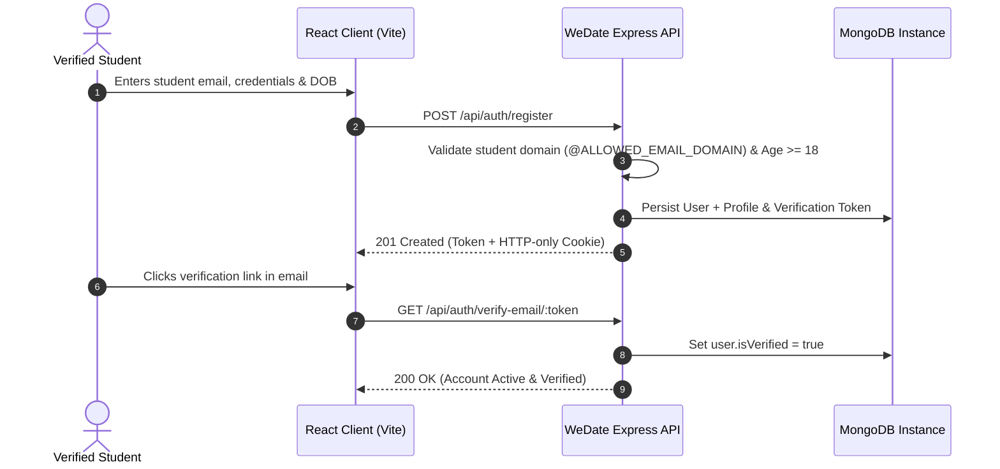
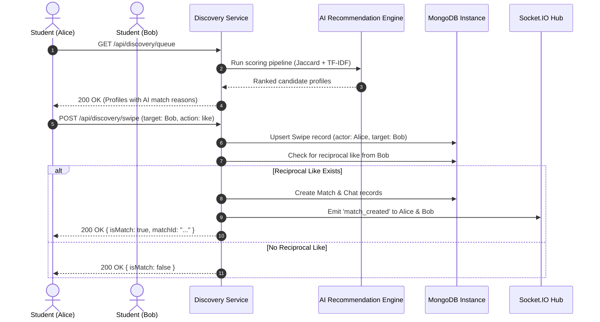
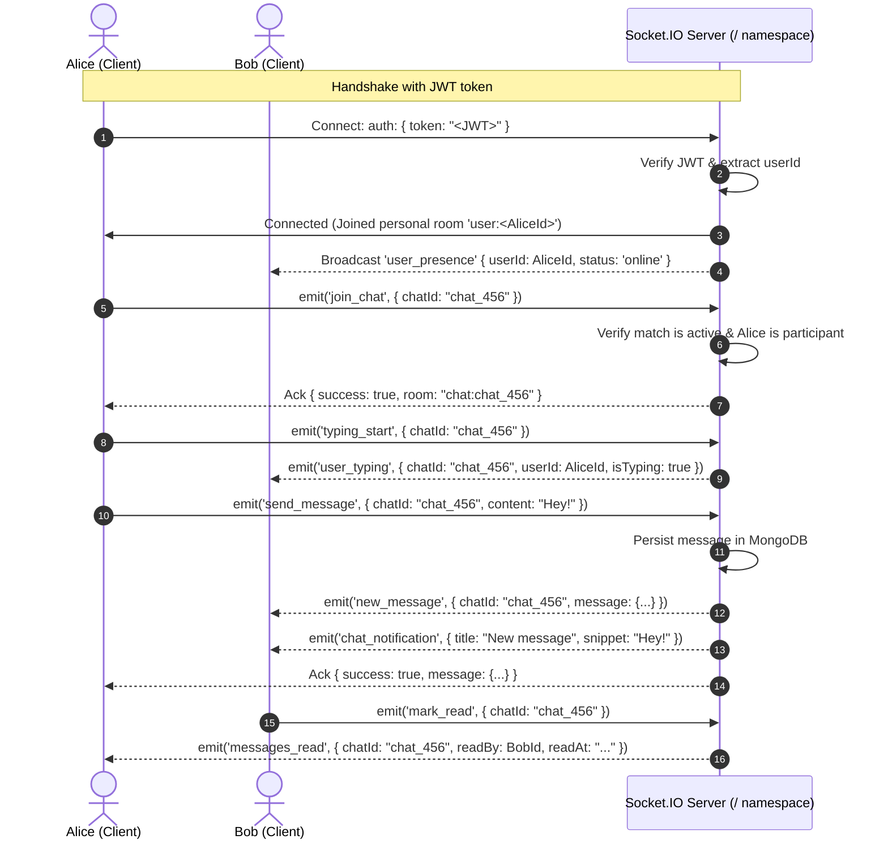

# WeDate REST API & Real-Time Socket Specification

**Version:** 1.0.0  
**Base URL:** `http://localhost:5000/api` (Production: `https://api.wedate.app/api`)  
**WebSocket URL:** `ws://localhost:5000` (Socket.IO namespace: `/`)  
**Target Environment:** Node.js / Express backend with MongoDB, JWT Authentication, Cloudinary Media Storage, and Real-Time Socket.IO.  
**Audience:** Verified student community dating web application.

---

## Table of Contents
1. [Architectural Overview & Standards](#1-architectural-overview--standards)
2. [Authentication & Authorization Model](#2-authentication--authorization-model)
3. [Global Status Codes & Error Handling](#3-global-status-codes--error-handling)
4. [Rate Limiting Policies](#4-rate-limiting-policies)
5. [Authentication Endpoints (`/api/auth`)](#5-authentication-endpoints-apiauth)
6. [Profile Management Endpoints (`/api/profiles`)](#6-profile-management-endpoints-apiprofiles)
7. [Discovery Endpoints (`/api/discovery`)](#7-discovery-endpoints-apidiscovery)
8. [AI Recommendation Engine Endpoints (`/api/recommendations`)](#8-ai-recommendation-engine-endpoints-apirecommendations)
9. [Matching Endpoints (`/api/matches`)](#9-matching-endpoints-apimatches)
10. [Chat & Messaging Endpoints (`/api/chats`)](#10-chat--messaging-endpoints-apichats)
11. [Notification Endpoints (`/api/notifications`)](#11-notification-endpoints-apinotifications)
12. [User Safety & Trust Endpoints (`/api/users`)](#12-user-safety--trust-endpoints-apiusers)
13. [Account Settings Endpoints (`/api/settings`)](#13-account-settings-endpoints-apisettings)
14. [System Health Check (`/api/health`)](#14-system-health-check-apihealth)
15. [Socket.IO Real-Time Event Protocol](#15-socketio-real-time-event-protocol)

---

## 1. Architectural Overview & Standards

The WeDate platform provides a high-performance RESTful API and real-time bidirectional event infrastructure designed for verified student communities.

### Request Headers
| Header | Value | Requirement | Description |
| :--- | :--- | :--- | :--- |
| `Content-Type` | `application/json` | Mandatory (unless multipart) | Specifies JSON payload formatting |
| `Authorization` | `Bearer <JWT_TOKEN>` | Required on secured routes | Cryptographic bearer token |
| `Accept` | `application/json` | Recommended | Expected response MIME format |

### Standard Response Structure
All JSON responses follow a standardized envelope format:

```json
{
  "success": true,
  "message": "Operation description or confirmation",
  "data": {}
}
```

On validation or system failure, error responses return:

```json
{
  "success": false,
  "message": "Human-readable error description",
  "code": "MACHINE_READABLE_CODE",
  "errors": ["Specific validation error item"]
}
```

---

## 2. Authentication & Authorization Model

Access is controlled via signed JSON Web Tokens (JWT) using the HMAC-SHA256 algorithm.



### Access Control Levels
1. **Public:** Accessible without credentials (e.g., registration, login, health check, password reset dispatch).
2. **Authenticated (`protect`):** Requires a valid, unexpired JWT passed via `Authorization: Bearer <token>` or HTTP-only `token` cookie.
3. **Verified Student (`requireVerified`):** Requires authentication plus verified student email status (`isVerified: true`).
4. **Completed Profile (`requireCompletedProfile`):** Requires verified authentication and an onboarding profile meeting minimum standards: valid name, age >= 18, assigned department, academic year, and at least one uploaded photo.

---

## 3. Global Status Codes & Error Handling

| Status Code | Reason Phrase | Typical Trigger Condition |
| :--- | :--- | :--- |
| `200 OK` | Standard Success | Successful retrieval, modification, or session state change |
| `201 Created` | Resource Created | Successful account creation, photo upload, message sent, report filed |
| `400 Bad Request` | Client Input Error | Missing mandatory fields, age < 18, invalid domain, file size > 5MB |
| `401 Unauthorized` | Auth Required | Missing, invalid, or expired JWT session token |
| `403 Forbidden` | Access Denied | Email unverified, incomplete profile, or account suspended |
| `404 Not Found` | Target Missing | User, profile, chat, photo, or match identifier does not exist |
| `409 Conflict` | Duplicate Resource | Student email already registered or duplicate unique constraint |
| `429 Too Many Requests` | Rate Limit Exceeded | Exceeded allowed request thresholds per 15-minute window |
| `500 Internal Error` | Server Exception | Uncaught runtime error or underlying database connection fault |

---

## 4. Rate Limiting Policies

To ensure platform reliability and security against brute-force attacks, express rate limiting is enforced:

* **General API Gateway (`/api/*`):** `300 requests` per 15-minute rolling window per client IP address.
* **Authentication Gateway (`/api/auth/*`):** `25 requests` per 15-minute rolling window per client IP address.

Standard response headers returned:
* `RateLimit-Limit`: Maximum requests permitted within window.
* `RateLimit-Remaining`: Remaining requests for the active period.
* `RateLimit-Reset`: UTC epoch timestamp indicating rate limit window refresh.

---

## 5. Authentication Endpoints (`/api/auth`)

All routes in this group are prefixed with `/api/auth`.

---

### 5.1 Register New User
* **Method & Path:** `POST /api/auth/register`
* **Access Level:** Public (Subject to `authLimiter`)
* **Description:** Creates an account restricted to verified student domains (`ALLOWED_EMAIL_DOMAIN`). Validates that the registrant is at least 18 years of age based on `dateOfBirth`. Dispatches an email verification token.

#### Request Headers
`Content-Type: application/json`

#### Request Body
| Field | Type | Required | Constraints / Description |
| :--- | :--- | :--- | :--- |
| `email` | `string` | Yes | Valid student email ending in configured `@ALLOWED_EMAIL_DOMAIN` |
| `password` | `string` | Yes | Minimum 8 characters |
| `confirmPassword` | `string` | Optional | Matching password confirmation |
| `name` | `string` | Yes | Student's display name (max 60 chars) |
| `dateOfBirth` | `string` | Yes | ISO 8601 date format (`YYYY-MM-DD`). Must derive age >= 18 |
| `gender` | `string` | Optional | `Woman`, `Man`, `Non-binary`, `Other` (Default: `Woman`) |
| `department` | `string` | Optional | Student academic faculty or department |
| `academicYear` | `string` | Optional | `First Year (FE)`, `Second Year (SE)`, `Third Year (TE)`, `Final Year (BE)`, `Postgraduate (PG)` |

```json
{
  "email": "student@campus.edu",
  "password": "SecurePassword123!",
  "confirmPassword": "SecurePassword123!",
  "name": "Alex Mercer",
  "dateOfBirth": "2003-08-15",
  "gender": "Non-binary",
  "department": "Computer Science",
  "academicYear": "Third Year (TE)"
}
```

#### Success Response (`201 Created`)
```json
{
  "success": true,
  "message": "Account created successfully. Please verify your campus email address.",
  "data": {
    "user": {
      "id": "670c5b364835bf076f809a11",
      "email": "student@campus.edu",
      "isVerified": false,
      "status": "active"
    },
    "profile": {
      "_id": "670c5b364835bf076f809a12",
      "user": "670c5b364835bf076f809a11",
      "name": "Alex Mercer",
      "age": 23,
      "gender": "Non-binary",
      "department": "Computer Science",
      "academicYear": "Third Year (TE)",
      "isCompleted": false,
      "isVisible": true
    },
    "token": "eyJhbGciOiJIUzI1NiIsInR5cCI6IkpXVCJ9..."
  }
}
```

#### Error Responses
* `400 Bad Request`: Missing mandatory parameters, student domain mismatch, or registrant is under 18 years old.
* `409 Conflict`: An account with this email address already exists.
* `429 Too Many Requests`: Rate limit threshold exceeded.

---

### 5.2 Verify Email Address
* **Method & Path:** `GET /api/auth/verify-email/:token`  
  *(Also supported via `POST /api/auth/verify-email` with JSON body `{ "token": "..." }`)*
* **Access Level:** Public
* **Description:** Consumes the single-use cryptographic token dispatched upon registration. Marks user account status as `isVerified: true` and clears the token.

#### Path / Query Parameters
| Parameter | Type | Required | Description |
| :--- | :--- | :--- | :--- |
| `token` | `string` | Yes | 64-character SHA-256 hex verification token |

#### Success Response (`200 OK`)
```json
{
  "success": true,
  "message": "Email verified successfully. Welcome to the WeDate verified community!"
}
```

#### Error Responses
* `400 Bad Request`: Verification token is missing or malformed.
* `404 Not Found`: Token is invalid or has expired past 24 hours.

---

### 5.3 Resend Verification Email
* **Method & Path:** `POST /api/auth/resend-verification`
* **Access Level:** Authenticated (`protect`) or Public with Body
* **Description:** Generates a fresh 24-hour verification token and dispatches a new verification email to the user's registered address.

#### Request Body
| Field | Type | Required | Description |
| :--- | :--- | :--- | :--- |
| `email` | `string` | Optional | If unauthenticated, target student email |

```json
{
  "email": "student@campus.edu"
}
```

#### Success Response (`200 OK`)
```json
{
  "success": true,
  "message": "A fresh verification link has been sent to your student email address."
}
```

---

### 5.4 User Login
* **Method & Path:** `POST /api/auth/login`
* **Access Level:** Public (Subject to `authLimiter`)
* **Description:** Authenticates a student via email and password. Issues a signed 7-day JWT via response payload and secure HTTP-only cookie.

#### Request Body
| Field | Type | Required | Description |
| :--- | :--- | :--- | :--- |
| `email` | `string` | Yes | Registered student email |
| `password` | `string` | Yes | Account password |

```json
{
  "email": "student@campus.edu",
  "password": "SecurePassword123!"
}
```

#### Success Response (`200 OK`)
Sets cookie: `token=<jwt>; HttpOnly; Max-Age=604800; Path=/; SameSite=Lax`

```json
{
  "success": true,
  "message": "Login successful.",
  "data": {
    "user": {
      "id": "670c5b364835bf076f809a11",
      "email": "student@campus.edu",
      "isVerified": true,
      "status": "active"
    },
    "profile": {
      "_id": "670c5b364835bf076f809a12",
      "user": "670c5b364835bf076f809a11",
      "name": "Alex Mercer",
      "age": 23,
      "department": "Computer Science",
      "isCompleted": true,
      "isVisible": true
    },
    "token": "eyJhbGciOiJIUzI1NiIsInR5cCI6IkpXVCJ9..."
  }
}
```

#### Error Responses
* `400 Bad Request`: Email or password omitted.
* `401 Unauthorized`: Invalid credentials provided.
* `403 Forbidden`: Account suspended for community guidelines violations.

---

### 5.5 User Logout
* **Method & Path:** `POST /api/auth/logout`
* **Access Level:** Authenticated (`protect`)
* **Description:** Invalidates the current session by clearing the HTTP-only authorization cookie.

#### Success Response (`200 OK`)
```json
{
  "success": true,
  "message": "Logged out successfully."
}
```

---

### 5.6 Forgot Password Dispatch
* **Method & Path:** `POST /api/auth/forgot-password`
* **Access Level:** Public (Subject to `authLimiter`)
* **Description:** Requests a password reset link. Dispatches a 1-hour reset token to the provided email if the account exists.

#### Request Body
```json
{
  "email": "student@campus.edu"
}
```

#### Success Response (`200 OK`)
```json
{
  "success": true,
  "message": "If an active account exists with that email, a password reset link has been dispatched."
}
```

---

### 5.7 Reset Password with Token
* **Method & Path:** `POST /api/auth/reset-password/:token`  
  *(Also accepts body `{ "token": "...", "newPassword": "...", "confirmPassword": "..." }`)*
* **Access Level:** Public (Subject to `authLimiter`)
* **Description:** Consumes the password reset token, validates the new password, and resets credentials.

#### Request Body
| Field | Type | Required | Description |
| :--- | :--- | :--- | :--- |
| `password` / `newPassword` | `string` | Yes | New password (min 8 characters) |
| `confirmPassword` | `string` | Optional | Matching confirmation |
| `token` | `string` | Optional | Provided in body if omitted in URL parameter |

```json
{
  "newPassword": "NewSecurePassword456!",
  "confirmPassword": "NewSecurePassword456!"
}
```

#### Success Response (`200 OK`)
```json
{
  "success": true,
  "message": "Your password has been reset successfully. You may now log in."
}
```

---

### 5.8 Get Current User & Profile
* **Method & Path:** `GET /api/auth/me`
* **Access Level:** Authenticated (`protect`)
* **Description:** Returns the authenticated user's account details, safety status, settings, and profile record.

#### Success Response (`200 OK`)
```json
{
  "success": true,
  "data": {
    "user": {
      "id": "670c5b364835bf076f809a11",
      "email": "student@campus.edu",
      "isVerified": true,
      "status": "active",
      "notificationPreferences": {
        "newMatches": true,
        "newMessages": true,
        "profileLikes": true,
        "emailAlerts": true
      },
      "privacySettings": {
        "profileVisibility": true,
        "personalizedRecommendations": true
      }
    },
    "profile": {
      "_id": "670c5b364835bf076f809a12",
      "user": "670c5b364835bf076f809a11",
      "name": "Alex Mercer",
      "age": 23,
      "gender": "Non-binary",
      "genderPreference": ["Everyone"],
      "department": "Computer Science",
      "academicYear": "Third Year (TE)",
      "bio": "Robotics enthusiast, coffee aficionado, looking for someone to explore campus cafes with.",
      "interests": ["Robotics", "Machine Learning", "Indie Rock", "Photography"],
      "hobbies": ["Badminton", "Bouldering", "Reading"],
      "relationshipGoals": ["Long-term relationship", "Friendship & Study partner"],
      "languages": ["English", "Spanish"],
      "photos": [
        {
          "_id": "670c5b364835bf076f809a99",
          "url": "https://res.cloudinary.com/wedate/image/upload/v1/profiles/p1.jpg",
          "isPrimary": true,
          "caption": "Campus library"
        }
      ],
      "isVisible": true,
      "isCompleted": true
    }
  }
}
```

---

## 6. Profile Management Endpoints (`/api/profiles`)

All routes in this group are prefixed with `/api/profiles`.

---

### 6.1 Get Own Profile
* **Method & Path:** `GET /api/profiles/me`
* **Access Level:** Authenticated (`protect`)
* **Description:** Retrieves the caller's complete profile document.

#### Success Response (`200 OK`)
```json
{
  "success": true,
  "data": {
    "_id": "670c5b364835bf076f809a12",
    "user": "670c5b364835bf076f809a11",
    "name": "Alex Mercer",
    "dateOfBirth": "2003-08-15T00:00:00.000Z",
    "age": 23,
    "gender": "Non-binary",
    "genderPreference": ["Everyone"],
    "department": "Computer Science",
    "academicYear": "Third Year (TE)",
    "bio": "Robotics and coffee lover.",
    "interests": ["Robotics", "Machine Learning", "Photography"],
    "hobbies": ["Badminton", "Bouldering"],
    "relationshipGoals": ["Long-term relationship"],
    "height": 178,
    "languages": ["English"],
    "photos": [
      {
        "_id": "670c5b364835bf076f809a99",
        "url": "https://res.cloudinary.com/wedate/image/upload/v1/profiles/p1.jpg",
        "isPrimary": true,
        "caption": "At the library"
      }
    ],
    "socialLinks": {
      "instagram": "alex_mercer",
      "linkedin": "alex-mercer",
      "spotify": "alex_beats"
    },
    "isVisible": true,
    "isCompleted": true
  }
}
```

---

### 6.2 Update Own Profile
* **Method & Path:** `PUT /api/profiles/me` *(also accepts `PATCH /api/profiles/me`)*
* **Access Level:** Authenticated + Verified (`requireVerified`)
* **Description:** Updates profile attributes. Evaluates profile completeness upon persistence.

#### Request Body Schema
| Field | Type | Description |
| :--- | :--- | :--- |
| `name` | `string` | Updated display name |
| `gender` | `string` | `Woman`, `Man`, `Non-binary`, `Other` |
| `genderPreference` | `string[]` | Array of preferences (`Woman`, `Man`, `Non-binary`, `Everyone`) |
| `department` | `string` | Academic faculty or department |
| `academicYear` | `string` | `First Year (FE)`, `Second Year (SE)`, `Third Year (TE)`, `Final Year (BE)`, `Postgraduate (PG)` |
| `bio` | `string` | Narrative biography (max 600 characters) |
| `interests` | `string[]` | Academic and personal interests |
| `hobbies` | `string[]` | Personal activities and sports |
| `relationshipGoals` | `string[]` | Goals: `Long-term relationship`, `Short-term relationship`, `Casual dating`, `Friendship & Study partner`, `Open to exploring` |
| `height` | `number` | Height in centimeters (100 - 230) |
| `languages` | `string[]` | Spoken languages |
| `socialLinks` | `object` | `{ instagram: string, linkedin: string, spotify: string }` |

```json
{
  "bio": "CS junior passionate about machine learning, chess, and indie music concerts.",
  "interests": ["Robotics", "Machine Learning", "Indie Rock", "Board Games"],
  "relationshipGoals": ["Long-term relationship", "Friendship & Study partner"],
  "height": 178
}
```

#### Success Response (`200 OK`)
```json
{
  "success": true,
  "message": "Profile updated successfully.",
  "data": {
    "_id": "670c5b364835bf076f809a12",
    "name": "Alex Mercer",
    "bio": "CS junior passionate about machine learning, chess, and indie music concerts.",
    "interests": ["Robotics", "Machine Learning", "Indie Rock", "Board Games"],
    "relationshipGoals": ["Long-term relationship", "Friendship & Study partner"],
    "isCompleted": true
  }
}
```

---

### 6.3 Get Profile by User ID
* **Method & Path:** `GET /api/profiles/:id`
* **Access Level:** Authenticated + Verified (`requireVerified`)
* **Description:** Retrieves the public profile of another student. Verifies that neither user has blocked the other, and that the target profile is visible.

#### Path Parameters
| Parameter | Type | Required | Description |
| :--- | :--- | :--- | :--- |
| `id` | `string` | Yes | Target user's MongoDB ObjectId |

#### Success Response (`200 OK`)
```json
{
  "success": true,
  "data": {
    "_id": "670c5b364835bf076f809b45",
    "user": "670c5b364835bf076f809a77",
    "name": "Samantha Wright",
    "age": 22,
    "gender": "Woman",
    "department": "Mechanical Engineering",
    "academicYear": "Final Year (BE)",
    "bio": "Designing race cars by day, reading sci-fi by night.",
    "interests": ["CAD Design", "Motorsport", "Sci-Fi", "Robotics"],
    "hobbies": ["Running", "Cooking"],
    "relationshipGoals": ["Long-term relationship"],
    "photos": [
      {
        "_id": "670c5b364835bf076f809c01",
        "url": "https://res.cloudinary.com/wedate/image/upload/v1/profiles/sam.jpg",
        "isPrimary": true,
        "caption": "Formula Student workshop"
      }
    ]
  }
}
```

#### Error Responses
* `404 Not Found`: Profile does not exist, profile visibility is toggled off, or a mutual block is in effect.

---

### 6.4 Upload Profile Photo
* **Method & Path:** `POST /api/profiles/photos`
* **Access Level:** Authenticated + Verified (`requireVerified`)
* **Description:** Uploads a photo to Cloudinary (or local storage). The first uploaded photo is automatically marked as primary. Maximum of 6 photos permitted per profile.

#### Request Headers
`Content-Type: multipart/form-data`

#### Form Fields
| Field | Type | Required | Description |
| :--- | :--- | :--- | :--- |
| `photo` | `binary file` | Yes | Image file (JPEG, PNG, WEBP). Maximum size: **5MB** |
| `caption` | `string` | Optional | Contextual photo caption (max 100 characters) |

#### Success Response (`201 Created`)
```json
{
  "success": true,
  "message": "Photo uploaded successfully.",
  "data": {
    "_id": "670c5b364835bf076f809a12",
    "photos": [
      {
        "_id": "670c5b364835bf076f809f88",
        "url": "https://res.cloudinary.com/wedate/image/upload/v172898/profiles/user_photo.jpg",
        "publicId": "wedate/profiles/sample_photo_id",
        "isPrimary": true,
        "caption": "Formula Student workshop"
      }
    ]
  }
}
```

#### Error Responses
* `400 Bad Request`: No file uploaded, unsupported MIME type, file exceeds 5MB, or user already has 6 photos.

---

### 6.5 Delete Profile Photo
* **Method & Path:** `DELETE /api/profiles/photos/:photoId`
* **Access Level:** Authenticated + Verified (`requireVerified`)
* **Description:** Deletes a photo from the database and Cloudinary storage. If the deleted photo was primary, another photo is designated as primary.

#### Path Parameters
| Parameter | Type | Required | Description |
| :--- | :--- | :--- | :--- |
| `photoId` | `string` | Yes | ObjectId of the photo subdocument |

#### Success Response (`200 OK`)
```json
{
  "success": true,
  "message": "Photo removed successfully.",
  "data": {
    "_id": "670c5b364835bf076f809a12",
    "photos": []
  }
}
```

---

### 6.6 Set Photo as Primary
* **Method & Path:** `PUT /api/profiles/photos/:photoId/primary` *(also accepts `PATCH`)*
* **Access Level:** Authenticated + Verified (`requireVerified`)
* **Description:** Sets the designated photo as `isPrimary: true` and marks all others as `false`.

#### Path Parameters
| Parameter | Type | Required | Description |
| :--- | :--- | :--- | :--- |
| `photoId` | `string` | Yes | Target photo ObjectId |

#### Success Response (`200 OK`)
```json
{
  "success": true,
  "message": "Primary photo updated.",
  "data": {
    "_id": "670c5b364835bf076f809a12",
    "photos": [
      {
        "_id": "670c5b364835bf076f809f88",
        "url": "https://res.cloudinary.com/wedate/image/upload/v1/profiles/p1.jpg",
        "isPrimary": true
      }
    ]
  }
}
```

---

### 6.7 Toggle Profile Visibility
* **Method & Path:** `PUT /api/profiles/visibility` *(also accepts `PATCH`)*
* **Access Level:** Authenticated + Verified (`requireVerified`)
* **Description:** Hides or reveals the user's profile in the discovery queue.

#### Request Body
| Field | Type | Required | Description |
| :--- | :--- | :--- | :--- |
| `isVisible` | `boolean` | Optional | If omitted, toggles the current state |

```json
{
  "isVisible": false
}
```

#### Success Response (`200 OK`)
```json
{
  "success": true,
  "message": "Profile is now hidden from discovery.",
  "data": {
    "isVisible": false
  }
}
```

---

## 7. Discovery Endpoints (`/api/discovery`)

All routes in this group are prefixed with `/api/discovery`.



---

### 7.1 Get Discovery Queue
* **Method & Path:** `GET /api/discovery/queue` *(also mounted at `GET /api/discovery`)*
* **Access Level:** Authenticated + Verified + Completed Profile (`requireCompletedProfile`)
* **Description:** Fetches an AI-ranked queue of eligible candidate profiles. Candidates are filtered against hard criteria (gender preference, mutual blocks, already-swiped users) and ranked using the content-based recommendation engine.

#### Query Parameters
| Parameter | Type | Required | Description |
| :--- | :--- | :--- | :--- |
| `page` | `integer` | No | Pagination page number (Default: `1`) |
| `limit` | `integer` | No | Batch size (Default: `20`, Max: `50`) |
| `minAge` | `integer` | No | Override minimum age filter |
| `maxAge` | `integer` | No | Override maximum age filter |
| `gender` | `string` | No | Filter candidates by gender |
| `department` | `string` | No | Filter candidates by academic faculty |
| `academicYear` | `string` | No | Filter candidates by academic year group |
| `interests` | `string` or `string[]` | No | Filter candidates having specific interests |

#### Success Response (`200 OK`)
```json
{
  "success": true,
  "data": {
    "totalEligible": 42,
    "isPersonalized": true,
    "candidates": [
      {
        "_id": "670c5b364835bf076f809c55",
        "user": "670c5b364835bf076f809a88",
        "name": "Jordan Lee",
        "age": 22,
        "gender": "Man",
        "department": "Electrical Engineering",
        "academicYear": "Final Year (BE)",
        "bio": "Building autonomous drones and listening to podcast deep-dives.",
        "interests": ["Robotics", "Embedded Systems", "Podcasts", "Indie Rock"],
        "hobbies": ["Badminton", "Cycling"],
        "relationshipGoals": ["Long-term relationship"],
        "photos": [
          {
            "url": "https://res.cloudinary.com/wedate/image/upload/v1/profiles/jordan.jpg",
            "isPrimary": true
          }
        ],
        "recommendationScore": 88,
        "reasons": [
          "Shared interest in Robotics",
          "Shared interest in Indie Rock",
          "Compatible relationship goals",
          "Shared hobby: Badminton"
        ]
      }
    ]
  }
}
```

---

### 7.2 Record Swipe Action
* **Method & Path:** `POST /api/discovery/swipe` *(also accepts `POST /api/discovery/:userId/swipe`)*
* **Access Level:** Authenticated + Verified + Completed Profile (`requireCompletedProfile`)
* **Description:** Records a swipe action (`like` or `pass`). If a reciprocal `like` exists, triggers automatic match generation, provisions a real-time chat room, dispatches in-app notifications, and broadcasts WebSocket alerts.

#### Request Body
| Field | Type | Required | Constraints |
| :--- | :--- | :--- | :--- |
| `targetUserId` | `string` | Yes* | MongoDB ObjectId of the target student (*if not in path) |
| `action` | `string` | Yes | Enum: `'like'` or `'pass'` |

```json
{
  "targetUserId": "670c5b364835bf076f809a88",
  "action": "like"
}
```

#### Success Response: Mutual Match Created (`200 OK`)
```json
{
  "success": true,
  "data": {
    "action": "like",
    "isMatch": true,
    "matchId": "670c5b364835bf076f809dd1",
    "chatId": "670c5b364835bf076f809ee2",
    "matchedProfile": {
      "name": "Jordan Lee",
      "photos": [
        {
          "url": "https://res.cloudinary.com/wedate/image/upload/v1/profiles/jordan.jpg",
          "isPrimary": true
        }
      ]
    }
  }
}
```

#### Success Response: Pass or Non-Mutual Like (`200 OK`)
```json
{
  "success": true,
  "data": {
    "action": "pass",
    "isMatch": false
  }
}
```

#### Error Responses
* `400 Bad Request`: Swiping on oneself, invalid action, or target profile incomplete.
* `404 Not Found`: Target user blocked or unavailable.

---

### 7.3 Get Discovery Filter Preferences
* **Method & Path:** `GET /api/discovery/filters`
* **Access Level:** Authenticated + Verified (`requireVerified`)
* **Description:** Retrieves the user's saved discovery filter criteria.

#### Success Response (`200 OK`)
```json
{
  "success": true,
  "data": {
    "minAge": 19,
    "maxAge": 26,
    "genders": ["Woman", "Non-binary"],
    "department": "",
    "academicYear": ""
  }
}
```

---

### 7.4 Update Discovery Filter Preferences
* **Method & Path:** `PUT /api/discovery/filters`
* **Access Level:** Authenticated + Verified (`requireVerified`)
* **Description:** Updates discovery filters.

#### Request Body
| Field | Type | Description |
| :--- | :--- | :--- |
| `minAge` / `ageRange.min` | `number` | Minimum age (>= 18) |
| `maxAge` / `ageRange.max` | `number` | Maximum age (<= 99) |
| `genders` / `gender` | `string[]` | Target gender categories |
| `department` | `string` | Filter to specific academic department |
| `academicYear` / `yearGroup` | `string` | Filter to specific year group |

```json
{
  "minAge": 20,
  "maxAge": 25,
  "genders": ["Woman", "Non-binary"],
  "department": "Engineering"
}
```

#### Success Response (`200 OK`)
```json
{
  "success": true,
  "message": "Filter preferences saved successfully.",
  "data": {
    "minAge": 20,
    "maxAge": 25,
    "genders": ["Woman", "Non-binary"],
    "department": "Engineering",
    "academicYear": ""
  }
}
```

---

### 7.5 Get Received Likes Statistics
* **Method & Path:** `GET /api/discovery/likes-stats`
* **Access Level:** Authenticated + Verified (`requireVerified`)
* **Description:** Returns the total count of active unreciprocated likes received by the authenticated student.

#### Success Response (`200 OK`)
```json
{
  "success": true,
  "data": {
    "count": 7,
    "hasNewLikes": true
  }
}
```

---

## 8. AI Recommendation Engine Endpoints (`/api/recommendations`)

Prefix: `/api/recommendations`

---

### 8.1 Get AI-Powered Recommendations
* **Method & Path:** `GET /api/recommendations`
* **Access Level:** Authenticated + Verified + Completed Profile (`requireCompletedProfile`)
* **Description:** Executes the hybrid content-based recommendation engine. Computes candidate compatibility utilizing:
  * **Interests Similarity (35% weight):** Jaccard index over curated student interest tokens.
  * **Hobbies & Lifestyle (20% weight):** Jaccard index over sports and recreational activities.
  * **Relationship Goal Matrix (20% weight):** Cross-comparison heuristic matrix evaluating student intent alignment.
  * **Bio Vector Similarity (15% weight):** TF-IDF term vectorization with cosine similarity scoring after stop-word filtering.
  * **Language Overlap (10% weight):** Jaccard index over spoken languages.

#### Success Response (`200 OK`)
```json
{
  "success": true,
  "meta": {
    "totalEvaluated": 38,
    "isPersonalized": true,
    "algorithm": "WeDate Smart Discovery (Content-Based: Jaccard + TF-IDF Cosine + Goal Matrix)"
  },
  "data": [
    {
      "_id": "670c5b364835bf076f809c55",
      "user": "670c5b364835bf076f809a88",
      "name": "Jordan Lee",
      "age": 22,
      "gender": "Man",
      "department": "Electrical Engineering",
      "academicYear": "Final Year (BE)",
      "bio": "Building autonomous drones and listening to podcast deep-dives.",
      "interests": ["Robotics", "Embedded Systems", "Podcasts", "Indie Rock"],
      "hobbies": ["Badminton", "Cycling"],
      "relationshipGoals": ["Long-term relationship"],
      "languages": ["English", "Mandarin"],
      "photos": [
        {
          "url": "https://res.cloudinary.com/wedate/image/upload/v1/profiles/jordan.jpg",
          "isPrimary": true
        }
      ],
      "recommendationScore": 91,
      "reasons": [
        "Shared interest in Robotics",
        "Shared interest in Indie Rock",
        "Both looking for Long-term relationship",
        "Shared hobby: Badminton"
      ],
      "breakdown": {
        "interestsScore": 0.50,
        "hobbiesScore": 0.50,
        "goalsScore": 1.00,
        "bioScore": 0.42,
        "languagesScore": 0.50
      }
    }
  ]
}
```

---

## 9. Matching Endpoints (`/api/matches`)

Prefix: `/api/matches`

---

### 9.1 List All Active Matches
* **Method & Path:** `GET /api/matches`
* **Access Level:** Authenticated + Verified (`requireVerified`)
* **Description:** Retrieves all active mutual matches for the authenticated student, including partner profile previews and last message metadata.

#### Success Response (`200 OK`)
```json
{
  "success": true,
  "data": [
    {
      "_id": "670c5b364835bf076f809dd1",
      "pairKey": "670c5b364835bf076f809a11_670c5b364835bf076f809a88",
      "isActive": true,
      "lastActivityAt": "2026-10-14T20:15:30.000Z",
      "createdAt": "2026-10-14T18:00:00.000Z",
      "otherProfile": {
        "user": "670c5b364835bf076f809a88",
        "name": "Jordan Lee",
        "age": 22,
        "department": "Electrical Engineering",
        "photos": [
          {
            "url": "https://res.cloudinary.com/wedate/image/upload/v1/profiles/jordan.jpg",
            "isPrimary": true
          }
        ]
      },
      "chat": {
        "_id": "670c5b364835bf076f809ee2",
        "lastMessage": {
          "text": "Hey! Loved your robotics project demo.",
          "createdAt": "2026-10-14T20:15:30.000Z"
        },
        "unreadCount": 1
      }
    }
  ]
}
```

---

### 9.2 Get Match Details
* **Method & Path:** `GET /api/matches/:id`
* **Access Level:** Authenticated + Verified (`requireVerified`)
* **Description:** Retrieves specific details for an individual match. Verifies that the requesting user is a legitimate participant.

#### Path Parameters
| Parameter | Type | Required | Description |
| :--- | :--- | :--- | :--- |
| `id` | `string` | Yes | Match MongoDB ObjectId |

#### Success Response (`200 OK`)
```json
{
  "success": true,
  "data": {
    "match": {
      "_id": "670c5b364835bf076f809dd1",
      "isActive": true,
      "users": ["670c5b364835bf076f809a11", "670c5b364835bf076f809a88"],
      "lastActivityAt": "2026-10-14T20:15:30.000Z"
    },
    "otherProfile": {
      "name": "Jordan Lee",
      "department": "Electrical Engineering",
      "bio": "Building autonomous drones and listening to podcast deep-dives.",
      "photos": [
        {
          "url": "https://res.cloudinary.com/wedate/image/upload/v1/profiles/jordan.jpg",
          "isPrimary": true
        }
      ]
    }
  }
}
```

#### Error Responses
* `404 Not Found`: Match does not exist or requesting user is not a participant.

---

### 9.3 Unmatch / Deactivate Match
* **Method & Path:** `DELETE /api/matches/:id`
* **Access Level:** Authenticated + Verified (`requireVerified`)
* **Description:** Deactivates a mutual match (`isActive: false`), records who initiated the unmatch, and closes communication channels.

#### Path Parameters
| Parameter | Type | Required | Description |
| :--- | :--- | :--- | :--- |
| `id` | `string` | Yes | Target Match ObjectId |

#### Success Response (`200 OK`)
```json
{
  "success": true,
  "message": "Match removed successfully."
}
```

---

## 10. Chat & Messaging Endpoints (`/api/chats`)

Prefix: `/api/chats`

---

### 10.1 List All Conversations
* **Method & Path:** `GET /api/chats/conversations` *(also mounted at `GET /api/chats`)*
* **Access Level:** Authenticated + Verified (`requireVerified`)
* **Description:** Lists all active chat rooms belonging to the student with last messages and unread counts.

#### Success Response (`200 OK`)
```json
{
  "success": true,
  "data": [
    {
      "_id": "670c5b364835bf076f809ee2",
      "match": "670c5b364835bf076f809dd1",
      "recipient": {
        "id": "670c5b364835bf076f809a88",
        "name": "Jordan Lee",
        "photo": "https://res.cloudinary.com/wedate/image/upload/v1/profiles/jordan.jpg"
      },
      "lastMessage": {
        "text": "Hey! Loved your robotics project demo.",
        "sender": "670c5b364835bf076f809a88",
        "createdAt": "2026-10-14T20:15:30.000Z"
      },
      "unreadCount": 1
    }
  ]
}
```

---

### 10.2 Get Chat for a Match
* **Method & Path:** `GET /api/chats/match/:matchId`
* **Access Level:** Authenticated + Verified (`requireVerified`)
* **Description:** Fetches or initializes the chat thread associated with a specific match ID. Returns room metadata and recent messages.

#### Path Parameters
| Parameter | Type | Required | Description |
| :--- | :--- | :--- | :--- |
| `matchId` | `string` | Yes | Match ObjectId |

#### Success Response (`200 OK`)
```json
{
  "success": true,
  "data": {
    "chat": {
      "_id": "670c5b364835bf076f809ee2",
      "match": "670c5b364835bf076f809dd1",
      "participants": ["670c5b364835bf076f809a11", "670c5b364835bf076f809a88"]
    },
    "messages": [
      {
        "_id": "670c5b364835bf076f80a112",
        "sender": "670c5b364835bf076f809a88",
        "content": "Hey! Loved your robotics project demo.",
        "messageType": "text",
        "isRead": true,
        "createdAt": "2026-10-14T20:15:30.000Z"
      }
    ],
    "pagination": {
      "total": 1,
      "page": 1,
      "pages": 1
    }
  }
}
```

---

### 10.3 Get Messages with Pagination
* **Method & Path:** `GET /api/chats/:chatId/messages`
* **Access Level:** Authenticated + Verified (`requireVerified`)
* **Description:** Retrieves paginated chronological messages for a chat room. Automatically marks received messages as read.

#### Path & Query Parameters
| Parameter | Type | In | Description |
| :--- | :--- | :--- | :--- |
| `chatId` | `string` | Path | Chat MongoDB ObjectId |
| `page` | `integer` | Query | Page index (Default: `1`) |
| `limit` | `integer` | Query | Message count per page (Default: `50`) |

#### Success Response (`200 OK`)
```json
{
  "success": true,
  "data": {
    "messages": [
      {
        "_id": "670c5b364835bf076f80a112",
        "chat": "670c5b364835bf076f809ee2",
        "sender": "670c5b364835bf076f809a88",
        "recipient": "670c5b364835bf076f809a11",
        "content": "Hey! Loved your robotics project demo.",
        "messageType": "text",
        "isRead": true,
        "createdAt": "2026-10-14T20:15:30.000Z"
      }
    ],
    "pagination": {
      "total": 1,
      "page": 1,
      "limit": 50,
      "pages": 1
    }
  }
}
```

---

### 10.4 Send Text Message
* **Method & Path:** `POST /api/chats/:chatId/messages`
* **Access Level:** Authenticated + Verified (`requireVerified`)
* **Description:** Sends a message in a conversation. Updates chat metadata and broadcasts to the recipient's room.

#### Request Body
| Field | Type | Required | Description |
| :--- | :--- | :--- | :--- |
| `content` | `string` | Yes | Message text (max 2000 chars) |
| `messageType` | `string` | Optional | `text` or `image` (Default: `text`) |
| `mediaUrl` | `string` | Optional | Hosted image URL if image message |

```json
{
  "content": "Thanks! Are you participating in the upcoming campus hackathon?",
  "messageType": "text"
}
```

#### Success Response (`201 Created`)
```json
{
  "success": true,
  "data": {
    "_id": "670c5b364835bf076f80a240",
    "chat": "670c5b364835bf076f809ee2",
    "match": "670c5b364835bf076f809dd1",
    "sender": "670c5b364835bf076f809a11",
    "recipient": "670c5b364835bf076f809a88",
    "content": "Thanks! Are you participating in the upcoming campus hackathon?",
    "messageType": "text",
    "isRead": false,
    "createdAt": "2026-10-14T20:20:00.000Z"
  }
}
```

---

### 10.5 Upload Chat Image
* **Method & Path:** `POST /api/chats/:chatId/messages/image` *(also mounted at `POST /api/chats/:chatId/media`)*
* **Access Level:** Authenticated + Verified (`requireVerified`)
* **Description:** Uploads an image attachment for a chat message to Cloudinary under `wedate/chat`.

#### Request Headers
`Content-Type: multipart/form-data`

#### Form Fields
| Field | Type | Required | Description |
| :--- | :--- | :--- | :--- |
| `image` | `binary` | Yes | File upload (max 5MB, JPG/PNG/WEBP) |

#### Success Response (`201 Created`)
```json
{
  "success": true,
  "data": {
    "url": "https://res.cloudinary.com/wedate/image/upload/v172898/chat/msg_img_921.jpg",
    "publicId": "wedate/chat/msg_img_921"
  }
}
```

---

## 11. Notification Endpoints (`/api/notifications`)

Prefix: `/api/notifications`

---

### 11.1 List Notifications
* **Method & Path:** `GET /api/notifications`
* **Access Level:** Authenticated + Verified (`requireVerified`)
* **Description:** Retrieves notification records for the student and returns the current total unread badge count.

#### Query Parameters
| Parameter | Type | Required | Description |
| :--- | :--- | :--- | :--- |
| `page` | `integer` | No | Pagination page index |
| `limit` | `integer` | No | Max entries to return (Default: `50`) |

#### Success Response (`200 OK`)
```json
{
  "success": true,
  "data": {
    "notifications": [
      {
        "_id": "670c5b364835bf076f80a991",
        "recipient": "670c5b364835bf076f809a11",
        "sender": "670c5b364835bf076f809a88",
        "type": "match",
        "title": "New Mutual Match!",
        "message": "You and Jordan liked each other! Start the conversation.",
        "data": {
          "matchId": "670c5b364835bf076f809dd1",
          "chatId": "670c5b364835bf076f809ee2"
        },
        "isRead": false,
        "createdAt": "2026-10-14T18:00:00.000Z"
      }
    ],
    "unreadCount": 1
  }
}
```

---

### 11.2 Mark Notification as Read
* **Method & Path:** `PUT /api/notifications/:id/read` *(also accepts `PATCH`)*
* **Access Level:** Authenticated + Verified (`requireVerified`)
* **Description:** Marks a single notification as read.

#### Path Parameters
| Parameter | Type | Required | Description |
| :--- | :--- | :--- | :--- |
| `id` | `string` | Yes | Target Notification ObjectId |

#### Success Response (`200 OK`)
```json
{
  "success": true,
  "data": {
    "_id": "670c5b364835bf076f80a991",
    "isRead": true
  }
}
```

---

### 11.3 Mark All Notifications as Read
* **Method & Path:** `PUT /api/notifications/read-all` *(also accepts `PATCH`)*
* **Access Level:** Authenticated + Verified (`requireVerified`)
* **Description:** Updates all unread notifications for the caller to `isRead: true`.

#### Success Response (`200 OK`)
```json
{
  "success": true,
  "message": "All notifications marked as read."
}
```

---

## 12. User Safety & Trust Endpoints (`/api/users`)

Prefix: `/api/users`

---

### 12.1 Block a User
* **Method & Path:** `POST /api/users/block/:userId` *(also mounted at `POST /api/users/:userId/block`)*
* **Access Level:** Authenticated + Verified (`requireVerified`)
* **Description:** Creates a block record. Deactivates existing matches, closes active chat rooms, and prevents either party from viewing each other in discovery.

#### Path Parameters
| Parameter | Type | Required | Description |
| :--- | :--- | :--- | :--- |
| `userId` | `string` | Yes | ObjectId of user to block |

#### Success Response (`200 OK`)
```json
{
  "success": true,
  "message": "User has been blocked. They can no longer see your profile or contact you."
}
```

---

### 12.2 Unblock a User
* **Method & Path:** `DELETE /api/users/block/:userId` *(also mounted at `DELETE /api/users/:userId/block`)*
* **Access Level:** Authenticated + Verified (`requireVerified`)
* **Description:** Removes a user from the caller's block list.

#### Path Parameters
| Parameter | Type | Required | Description |
| :--- | :--- | :--- | :--- |
| `userId` | `string` | Yes | Target user's ObjectId |

#### Success Response (`200 OK`)
```json
{
  "success": true,
  "message": "User unblocked successfully."
}
```

---

### 12.3 List Blocked Users
* **Method & Path:** `GET /api/users/blocked`
* **Access Level:** Authenticated + Verified (`requireVerified`)
* **Description:** Retrieves all accounts currently blocked by the authenticated student.

#### Success Response (`200 OK`)
```json
{
  "success": true,
  "data": [
    {
      "blockId": "670c5b364835bf076f80b112",
      "blockedUser": {
        "id": "670c5b364835bf076f809f99",
        "name": "Reported Student"
      },
      "blockedAt": "2026-10-12T14:22:00.000Z"
    }
  ]
}
```

---

### 12.4 Report a User
* **Method & Path:** `POST /api/users/report/:userId` *(also mounted at `POST /api/users/:userId/report`)*
* **Access Level:** Authenticated + Verified (`requireVerified`)
* **Description:** Submits a safety violation report and automatically applies an instant mutual block between both users.

#### Request Body
| Field | Type | Required | Valid Options |
| :--- | :--- | :--- | :--- |
| `reason` | `string` | Yes | `Harassment or bullying`<br>`Inappropriate or explicit photos`<br>`Spam or commercial promotion`<br>`Fake profile or impersonation`<br>`Underage user`<br>`Hate speech`<br>`Other safety concern` |
| `details` | `string` | Optional | Contextual details (max 1000 characters) |

```json
{
  "reason": "Harassment or bullying",
  "details": "Sent uninvited harassing messages through chat."
}
```

#### Success Response (`201 Created`)
```json
{
  "success": true,
  "message": "Thank you for keeping our community safe. Your report has been logged and the user has been blocked.",
  "data": {
    "id": "670c5b364835bf076f80b555",
    "status": "pending"
  }
}
```

---

## 13. Account Settings Endpoints (`/api/settings`)

Prefix: `/api/settings`

---

### 13.1 Get Notification Preferences
* **Method & Path:** `GET /api/settings/notifications`
* **Access Level:** Authenticated + Verified (`requireVerified`)
* **Description:** Returns the student's notification preferences.

#### Success Response (`200 OK`)
```json
{
  "success": true,
  "data": {
    "newMatches": true,
    "newMessages": true,
    "profileLikes": true,
    "emailAlerts": true
  }
}
```

---

### 13.2 Update Notification Preferences
* **Method & Path:** `PUT /api/settings/notifications` *(also accepts `PATCH`)*
* **Access Level:** Authenticated + Verified (`requireVerified`)
* **Description:** Modifies notification preferences.

#### Request Body
```json
{
  "newMatches": true,
  "newMessages": true,
  "profileLikes": false,
  "emailAlerts": false
}
```

#### Success Response (`200 OK`)
```json
{
  "success": true,
  "message": "Notification preferences updated.",
  "data": {
    "newMatches": true,
    "newMessages": true,
    "profileLikes": false,
    "emailAlerts": false
  }
}
```

---

### 13.3 Get Privacy Settings
* **Method & Path:** `GET /api/settings/privacy`
* **Access Level:** Authenticated + Verified (`requireVerified`)
* **Description:** Returns the student's current privacy configuration.

#### Success Response (`200 OK`)
```json
{
  "success": true,
  "data": {
    "profileVisibility": true,
    "personalizedRecommendations": true
  }
}
```

---

### 13.4 Update Privacy Settings
* **Method & Path:** `PUT /api/settings/privacy` *(also accepts `PATCH`)*
* **Access Level:** Authenticated + Verified (`requireVerified`)
* **Description:** Modifies discovery visibility and personalized recommendation flags.

#### Request Body
```json
{
  "profileVisibility": true,
  "personalizedRecommendations": true
}
```

#### Success Response (`200 OK`)
```json
{
  "success": true,
  "message": "Privacy settings updated successfully.",
  "data": {
    "profileVisibility": true,
    "personalizedRecommendations": true
  }
}
```

---

### 13.5 Change Password
* **Method & Path:** `PUT /api/settings/password` *(also accepts `PATCH`)*
* **Access Level:** Authenticated + Verified (`requireVerified`)
* **Description:** Verifies the current password and sets a new password (min 8 characters).

#### Request Body
| Field | Type | Required | Constraints |
| :--- | :--- | :--- | :--- |
| `currentPassword` | `string` | Yes | Existing password |
| `newPassword` | `string` | Yes | New password (min 8 chars) |

```json
{
  "currentPassword": "SecurePassword123!",
  "newPassword": "UpdatedPassword456!"
}
```

#### Success Response (`200 OK`)
```json
{
  "success": true,
  "message": "Password changed successfully."
}
```

#### Error Responses
* `400 Bad Request`: Password requirements not met.
* `401 Unauthorized`: Current password is incorrect.

---

### 13.6 Delete Account
* **Method & Path:** `DELETE /api/settings/account`
* **Access Level:** Authenticated + Verified (`requireVerified`)
* **Description:** Permanently deletes account data (profile, photos, swipes, messages, and settings). Clears authorization cookies.

#### Request Body
| Field | Type | Required | Constraints |
| :--- | :--- | :--- | :--- |
| `confirmation` | `string` | Yes | Must be the exact literal string `"DELETE"` |

```json
{
  "confirmation": "DELETE"
}
```

#### Success Response (`200 OK`)
```json
{
  "success": true,
  "message": "Your WeDate account and associated data have been permanently removed."
}
```

---

## 14. System Health Check (`/api/health`)

* **Method & Path:** `GET /api/health`
* **Access Level:** Public
* **Description:** Returns operational readiness and version metadata.

#### Success Response (`200 OK`)
```json
{
  "status": "healthy",
  "timestamp": "2026-10-14T20:30:00.000Z",
  "service": "WeDate API & AI Recommendation Engine",
  "version": "1.0.0"
}
```

---

## 15. Socket.IO Real-Time Event Protocol

Real-time capabilities (live messaging, typing indicators, read receipts, and presence tracking) are powered by Socket.IO.



### Connection & Authentication Handshake
Clients must provide the user's JWT bearer token during connection initialization:

```javascript
import { io } from 'socket.io-client';

const socket = io('http://localhost:5000', {
  auth: {
    token: userToken // Or passed via Authorization header / query
  },
  withCredentials: true,
  transports: ['websocket', 'polling']
});
```

### Room Architecture
* `user:<userId>`: Private single-user room for account alerts, new match notifications, and direct incoming chat alerts.
* `chat:<chatId>`: Shared room for participants in an active match conversation.

---

### Client-to-Server Events (Outbound)

| Event Name | Payload | Callback Signature | Description |
| :--- | :--- | :--- | :--- |
| `join_chat` | `{ chatId: string }` | `(ack: { success: boolean, room?: string, message?: string }) => void` | Joins a conversation room. Server validates membership and match active status. |
| `send_message` | `{ chatId: string, content: string, messageType?: 'text'\|'image', mediaUrl?: string }` | `(ack: { success: boolean, message?: object }) => void` | Transmits a message, writes to database, and relays to the chat room. |
| `typing_start` | `{ chatId: string }` | None | Broadcasts typing state to other participant. |
| `typing_stop` | `{ chatId: string }` | None | Halts typing indicator. |
| `mark_read` | `{ chatId: string }` | None | Marks unread messages as read and sends read receipts. |
| `check_presence` | `{ targetUserId: string }` | `(res: { userId: string, status: 'online'\|'offline' }) => void` | Queries real-time online status of a mutual contact. |

---

### Server-to-Client Events (Inbound)

| Event Name | Payload Schema | Description |
| :--- | :--- | :--- |
| `new_message` | `{ chatId: string, message: MessageObject }` | Delivered to participants inside `chat:<chatId>`. |
| `typing` / `user_typing` | `{ chatId: string, userId: string, isTyping: boolean }` | Broadcast to chat room when partner starts/stops typing. |
| `stop_typing` | `{ chatId: string, userId: string }` | Emitted when partner ceases typing activity. |
| `messages_read` | `{ chatId: string, readBy: string, readAt: string }` | Emitted when recipient views messages in the room. |
| `user_online` / `user_presence` | `{ userId: string, status: 'online'\|'offline' }` | Broadcast across mutual contacts when online status changes. |
| `user_offline` | `{ userId: string, status: 'offline' }` | Emitted when all sockets for a user disconnect. |
| `new_notification` / `chat_notification` | `{ chatId?: string, title: string, snippet: string, message?: object }` | Targeted alert to `user:<userId>` when receiving messages while outside room. |
| `match_created` | `{ match: MatchObject }` | Dispatched to both students immediately upon reciprocal swipe `like`. |

---

## 16. Summary & Route Quick Reference

| Route Prefix | Method | Endpoint Path | Auth Guard | Summary |
| :--- | :--- | :--- | :--- | :--- |
| `/api/auth` | `POST` | `/register` | Public (Limit) | Register student with 18+ check |
| `/api/auth` | `GET` | `/verify-email/:token` | Public | Verify student email |
| `/api/auth` | `POST` | `/resend-verification` | Optional | Resend verification email |
| `/api/auth` | `POST` | `/login` | Public (Limit) | Student login (returns token/cookie) |
| `/api/auth` | `POST` | `/logout` | Authenticated | Clears auth session cookie |
| `/api/auth` | `POST` | `/forgot-password` | Public (Limit) | Dispatch password reset token |
| `/api/auth` | `POST` | `/reset-password/:token` | Public (Limit) | Reset account password |
| `/api/auth` | `GET` | `/me` | Authenticated | Fetch active user & profile |
| `/api/profiles` | `GET` | `/me` | Authenticated | Get own profile document |
| `/api/profiles` | `PUT` | `/me` | Verified | Update own profile |
| `/api/profiles` | `GET` | `/:id` | Verified | View other student profile |
| `/api/profiles` | `POST` | `/photos` | Verified | Upload profile photo (max 5MB) |
| `/api/profiles` | `DELETE` | `/photos/:photoId` | Verified | Remove profile photo |
| `/api/profiles` | `PUT` | `/photos/:photoId/primary` | Verified | Set primary display photo |
| `/api/profiles` | `PUT` | `/visibility` | Verified | Toggle discovery visibility |
| `/api/discovery` | `GET` | `/queue` | Completed Profile | Fetch AI-ranked candidates |
| `/api/discovery` | `POST` | `/swipe` | Completed Profile | Record like/pass, mutual match check |
| `/api/discovery` | `GET` | `/filters` | Verified | Fetch saved discovery filters |
| `/api/discovery` | `PUT` | `/filters` | Verified | Update discovery filters |
| `/api/discovery` | `GET` | `/likes-stats` | Verified | Count received unreciprocated likes |
| `/api/recommendations` | `GET` | `/` | Completed Profile | Run content-based AI engine |
| `/api/matches` | `GET` | `/` | Verified | List all active mutual matches |
| `/api/matches` | `GET` | `/:id` | Verified | Get match details (participant only) |
| `/api/matches` | `DELETE` | `/:id` | Verified | Unmatch & close conversation |
| `/api/chats` | `GET` | `/conversations` | Verified | List active chat conversations |
| `/api/chats` | `GET` | `/match/:matchId` | Verified | Get or create chat for match |
| `/api/chats` | `GET` | `/:chatId/messages` | Verified | Get paginated message history |
| `/api/chats` | `POST` | `/:chatId/messages` | Verified | Send text message |
| `/api/chats` | `POST` | `/:chatId/messages/image` | Verified | Upload chat image |
| `/api/notifications` | `GET` | `/` | Verified | List notifications & unread count |
| `/api/notifications` | `PUT` | `/:id/read` | Verified | Mark single notification read |
| `/api/notifications` | `PUT` | `/read-all` | Verified | Mark all notifications read |
| `/api/users` | `POST` | `/block/:userId` | Verified | Block user & deactivate match |
| `/api/users` | `DELETE` | `/block/:userId` | Verified | Unblock user |
| `/api/users` | `GET` | `/blocked` | Verified | View blocked users list |
| `/api/users` | `POST` | `/report/:userId` | Verified | File safety report & auto-block |
| `/api/settings` | `GET` | `/notifications` | Verified | Get notification preferences |
| `/api/settings` | `PUT` | `/notifications` | Verified | Update notification preferences |
| `/api/settings` | `GET` | `/privacy` | Verified | Get privacy settings |
| `/api/settings` | `PUT` | `/privacy` | Verified | Update privacy settings |
| `/api/settings` | `PUT` | `/password` | Verified | Change account password |
| `/api/settings` | `DELETE` | `/account` | Verified | Delete account (confirm: 'DELETE') |
| `/api/health` | `GET` | `/api/health` | Public | System status and service version |
