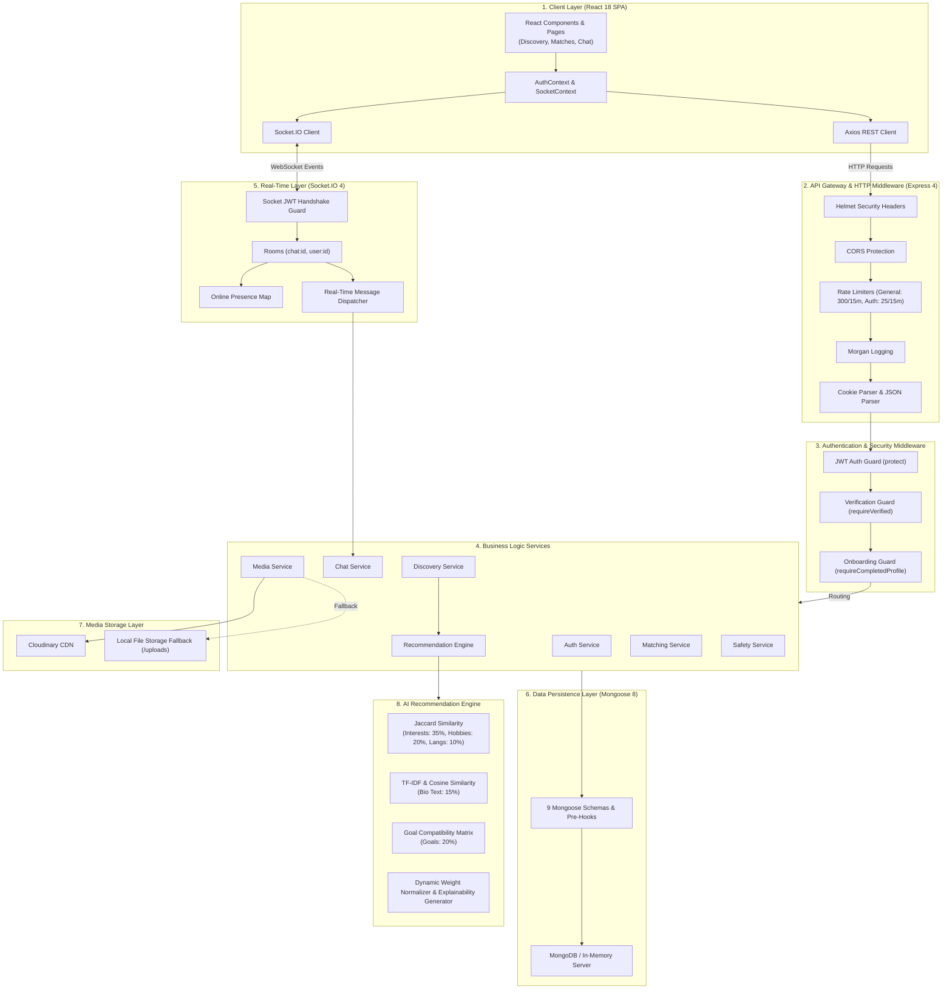
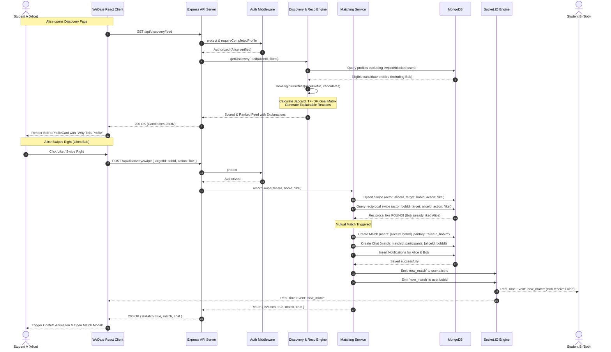
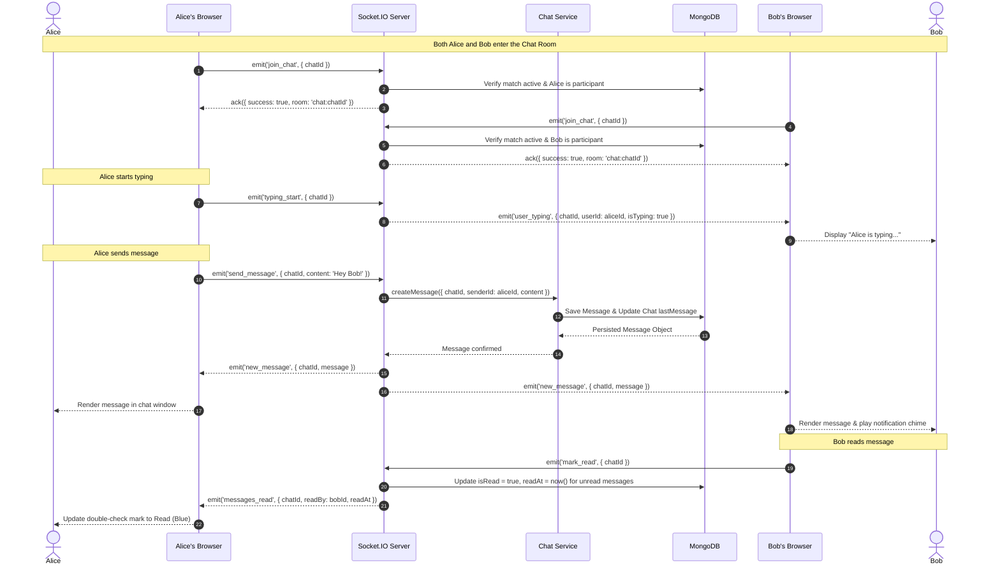

# WeDate — System Architecture Documentation

Welcome to the comprehensive architecture specification for **WeDate**, an AI-powered full-stack MERN dating web application engineered specifically for verified student communities.

---

## 1. Architectural Overview & Design Philosophy

WeDate is designed around privacy, academic trust, and algorithmic transparency. Unlike conventional dating platforms that rely on black-box heuristics or superficial swipe loops, WeDate combines:

1. **Strict Community Verification**: Access is restricted strictly to users with active student community email addresses (`ALLOWED_EMAIL_DOMAIN`).
2. **Deterministic, Explainable AI Recommendations**: A multi-component content-based recommendation engine analyzes shared academic interests, lifestyle hobbies, relationship compatibility, spoken languages, and biography semantics, delivering transparent reasons for every recommendation (e.g., *"You both share an interest in Robotics"*).
3. **Real-Time Interactive Engagement**: Bidirectional WebSockets power real-time messaging, instant mutual-match notifications, typing indicators, read receipts, and live student presence.
4. **Resilient Local & Cloud Fallbacks**: Built with zero external service lock-in; supports MongoDB Atlas or embedded `mongodb-memory-server`, Cloudinary CDN or local filesystem storage, and production SMTP or dev json mailers.

---

## 2. Technology Stack

| Layer | Technologies & Libraries | Key Responsibilities |
| :--- | :--- | :--- |
| **Frontend SPA** | React 18, Vite 6, React Router DOM 6 | Modern, component-driven client; client-side routing; protected route guards; optimized bundling with HMR. |
| **UI & Styling** | Custom CSS Variables Design System, Lucide React, Canvas Confetti | Accessible, responsive theme system (Editorial Serif + Clean Sans typography); micro-interactions; celebratory confetti on mutual match. |
| **Client Networking** | Axios, Socket.IO Client 4 | RESTful API consumer with credentials support; persistent WebSocket connection for instant event propagation. |
| **Backend Runtime** | Node.js (ESM, `type: module`), Express 4 | High-performance asynchronous HTTP server, REST API routing, centralized error handling. |
| **Security & Middleware**| Helmet 8, CORS, Express Rate Limit 7, Cookie-Parser, Morgan | HTTP security header hardening, IP-based request throttling, cross-origin request protection, HTTP access logging. |
| **Data Validation** | Zod 3, Mongoose Schema Validators | Strict compile-time and runtime validation of incoming payloads, schema constraints, and data sanitization. |
| **Database & ODM** | MongoDB, Mongoose 8, `mongodb-memory-server` 10 | Document-oriented persistence with compound indexes, pre-validate hooks, deterministic keys, and an in-memory dev database fallback. |
| **Authentication** | JSON Web Tokens (`jsonwebtoken` 9), `bcryptjs` 3, Node Crypto | Stateless JWT token issuance via both `Authorization: Bearer` and `httpOnly` cookies; 12 salt rounds password hashing; cryptographically secure single-use hex tokens. |
| **Media Handling** | Cloudinary SDK v2, Multer 1.4 | Multipart form parsing in-memory (5MB limit, strict MIME filter); streaming to Cloudinary cloud storage or local disk fallback (`/uploads`). |
| **Communication** | Socket.IO 4, Nodemailer 6 | Real-time chat namespaces and room channels; transactional emails for student email verification and password reset. |
| **AI Recommendation** | Custom Content-Based Engine | Mathematical Jaccard set similarity, TF-IDF biographical tokenization with Cosine similarity, and normalized weighted compatibility scoring. |

---

## 3. Monorepo Project Structure

```
WeDate/
├── package.json                   # Root monorepo orchestrator (concurrently)
├── .env.example                   # Master environment template
├── .gitignore                     # Git exclusions
├── client/                        # Frontend Single Page Application
│   ├── index.html                 # Entry HTML (DM Serif Display & Plus Jakarta Sans)
│   ├── vite.config.js             # Vite config with proxy for /api & /socket.io
│   ├── package.json               # Client dependencies and scripts
│   ├── public/
│   │   └── favicon.svg            # WeDate brand favicon
│   └── src/
│       ├── main.jsx               # React DOM mounting root
│       ├── App.jsx                # Router setup, global layout, route guards
│       ├── contexts/              # Global state contexts
│       │   ├── AuthContext.jsx    # User session, login, register, profile refresh
│       │   └── SocketContext.jsx  # Real-time WebSocket lifecycle & event dispatcher
│       ├── services/              # Client networking abstractions
│       │   ├── api.js             # Axios instance, interceptors, API endpoints
│       │   └── socket.js          # Socket.IO connection manager
│       ├── components/            # Reusable UI components
│       │   ├── common/            # Primitive UI (Button, Modal, ChipSelect)
│       │   ├── layout/            # Shell UI (Navbar, Footer)
│       │   ├── discovery/         # Recommendation UI (ProfileCard, WhyThisProfile, FilterModal)
│       │   ├── chat/              # Messaging UI (ChatWindow, ConversationList, MessageBubble)
│       │   └── safety/            # Trust & Safety UI (ReportModal, SafetyDisclaimer)
│       ├── pages/                 # Application views (14 core pages)
│       │   ├── LandingPage.jsx    # Marketing and community value proposition
│       │   ├── LoginPage.jsx      # Student credentials sign-in
│       │   ├── RegisterPage.jsx   # Multi-step registration with domain guard
│       │   ├── VerifyEmailPage.jsx# One-click email verification view
│       │   ├── ForgotPasswordPage.jsx # Password recovery initiation
│       │   ├── ResetPasswordPage.jsx  # New password submission
│       │   ├── OnboardingPage.jsx # Profile creation wizard (photos, interests, goals)
│       │   ├── DiscoveryPage.jsx  # AI Smart Discovery swipe interface
│       │   ├── MatchesPage.jsx    # Mutual connections grid & active matches
│       │   ├── ChatPage.jsx       # Real-time messaging and active conversations
│       │   ├── NotificationsPage.jsx  # Real-time and persistent alerts center
│       │   ├── ProfilePage.jsx    # Self-profile view and edit mode
│       │   ├── SettingsPage.jsx   # Account controls, blocked list, privacy toggles
│       │   ├── TermsPage.jsx      # Community terms of service
│       │   └── PrivacyPage.jsx    # Student privacy policy and data guarantees
│       └── styles/
│           └── index.css          # Design system tokens, utilities, and components
├── server/                        # Backend REST API & Real-Time Engine
│   ├── package.json               # Server dependencies (ESM, type: module)
│   ├── scripts/                   # Database maintenance & evaluation tools
│   │   ├── seed.js                # Realistic mock dataset generator
│   │   └── evaluate-recommendations.js # Quantitative AI engine benchmark
│   ├── tests/                     # Unit and integration test suites
│   │   ├── recommendation.test.js # 18 exhaustive recommendation engine tests
│   │   └── authAndMatching.test.js# 8 core security and matching workflow tests
│   ├── uploads/                   # Local media fallback directory
│   └── src/
│       ├── server.js              # HTTP server & WebSocket bootstrap
│       ├── app.js                 # Express application middleware pipeline
│       ├── config/                # Central configuration modules
│       │   ├── db.js              # MongoDB connection & memory-server fallback
│       │   ├── jwt.js             # JWT signing and verification helpers
│       │   ├── cloudinary.js      # Cloudinary v2 SDK configuration
│       │   ├── email.js           # Nodemailer transport & mail sender
│       │   └── recommendationConfig.js # AI feature weights & goal matrix
│       ├── middleware/            # Request processing middleware
│       │   ├── auth.js            # JWT protection, email verification, profile completion
│       │   ├── errorHandler.js    # Global centralized error handler
│       │   ├── rateLimiter.js     # General (300/15m) and Auth (25/15m) rate limiters
│       │   └── upload.js          # Multer memory buffer and MIME validator
│       ├── models/                # Mongoose schemas & data models (9 models)
│       │   ├── User.js            # Credentials, status, verification, preferences
│       │   ├── Profile.js         # Student bio, photos, academic year, department
│       │   ├── Swipe.js           # Directed like/pass interactions
│       │   ├── Match.js           # Mutual matches with unique pairKey
│       │   ├── Chat.js            # Conversation channel with metadata
│       │   ├── Message.js         # Individual chat messages
│       │   ├── Notification.js    # In-app push notifications
│       │   ├── Block.js           # User blocking records
│       │   └── Report.js          # Moderation and abuse reports
│       ├── services/              # Decoupled business logic services
│       │   ├── authService.js     # User registration, verification, login, recovery
│       │   ├── discoveryService.js# Profile eligibility filtering and feed retrieval
│       │   ├── recommendationService.js # AI scoring (Jaccard, TF-IDF, Cosine)
│       │   ├── matchingService.js # Swipe evaluation, match creation, notification
│       │   ├── chatService.js     # Message creation, history, unread counters
│       │   ├── safetyService.js   # User blocking, reporting, match deactivation
│       │   ├── mediaService.js    # Cloudinary upload and local filesystem fallback
│       │   └── emailService.js    # Email templates and dispatch
│       ├── controllers/           # HTTP request handlers
│       │   ├── authController.js
│       │   ├── profileController.js
│       │   ├── discoveryController.js
│       │   ├── recommendationController.js
│       │   ├── matchController.js
│       │   ├── chatController.js
│       │   ├── notificationController.js
│       │   ├── userController.js
│       │   └── settingsController.js
│       ├── routes/                # Express endpoint definitions
│       │   ├── authRoutes.js
│       │   ├── profileRoutes.js
│       │   ├── discoveryRoutes.js
│       │   ├── recommendationRoutes.js
│       │   ├── matchRoutes.js
│       │   ├── chatRoutes.js
│       │   ├── notificationRoutes.js
│       │   ├── userRoutes.js
│       │   └── settingsRoutes.js
│       └── sockets/
│           └── chatSocket.js      # Socket.IO connection handling & events
└── docs/                          # Comprehensive technical documentation
    ├── architecture.md            # System architecture and data flow
    ├── database.md                # Database schemas, relationships, and ER diagram
    └── security.md                # Security practices, threat model, and safeguards
```

---

## 4. Architectural Layers

The WeDate platform is structured into 8 distinct layers designed for clear separation of concerns, high maintainability, and horizontal scalability:



### Detailed Layer Breakdown

#### Layer 1: Client Application (React 18 SPA)
- Bootstrapped using Vite 6 for instant Hot Module Replacement (HMR) and optimized build times.
- Context-driven state management:
  - `AuthContext`: Manages user credentials, profile synchronization, login/logout, and onboarding state.
  - `SocketContext`: Manages the lifecycle of the Socket.IO connection, active conversation rooms, typing events, presence notifications, and unread counters.
- Client-side route protection prevents unauthenticated users from accessing protected views and redirects unverified or incomplete profiles to appropriate onboarding checkpoints.

#### Layer 2: API Gateway & HTTP Middleware
- Serves as the single HTTP ingestion point for all REST endpoints (`/api/*`).
- **Helmet**: Enforces modern security headers, Content Security Policy (CSP), and disables cross-origin information leaks (`crossOriginResourcePolicy: { policy: 'cross-origin' }`).
- **CORS**: Enforces origin verification while permitting credential inclusion (`credentials: true`).
- **Rate Limiters**: Defends against brute-force attacks and denial-of-service attempts by partitioning requests into general (300 requests / 15 minutes) and sensitive authentication endpoints (25 requests / 15 minutes).
- **Body & Cookie Parsers**: Safely parses JSON payloads (10MB limit) and parses HTTP-only session cookies.

#### Layer 3: Authentication & Authorization Middleware
- `protect`: Extracts the JWT from the `Authorization: Bearer <token>` header or `token` cookie, validates the cryptographic signature, checks user status (`active`, `suspended`, `deleted`), and attaches `req.user` to the request.
- `requireVerified`: Blocks users who have not yet confirmed their campus email address from performing matching, messaging, or discovery actions.
- `requireCompletedProfile`: Ensures a student has completed their profile (name, valid date of birth, department, academic year, and at least one uploaded photo) before entering the discovery pool.

#### Layer 4: Business Logic Services
- Pure business logic isolated from HTTP transport controllers:
  - `authService`: Handles hashing, single-use token creation, verification logic, and domain checking.
  - `discoveryService`: Executes database queries to fetch eligible candidate profiles, applying gender preferences, age ranges, academic filters, and exclusion of already-swiped or blocked users.
  - `matchingService`: Processes swipe actions, detects reciprocal likes, initializes mutual matches, and provisions chat threads.
  - `chatService`: Manages message persistence, retrieves conversation history, and handles unread counters.
  - `safetyService`: Manages blocking, reporting, and cascading deactivation of matches.
  - `mediaService`: Manages photo uploads with automated Cloudinary transformations or local static file fallback.

#### Layer 5: Real-Time Engine (Socket.IO 4)
- Shares authentication standards with the REST API by validating JWT tokens during the initial WebSocket handshake.
- Dispatches socket traffic into isolated rooms:
  - `user:<userId>`: Personal channel for global alerts, match notifications, and direct invites.
  - `chat:<chatId>`: Dedicated channel for conversation participants to exchange messages, typing indicators, and read receipts.
- Tracks real-time presence across multiple client instances via an in-memory `onlineUsers` connection registry.

#### Layer 6: Data Persistence Layer (Mongoose 8 & MongoDB)
- 9 schemas defined with strict data typing, default values, pre-validation hooks, and compound indexes.
- Pre-save lifecycle hooks automate password hashing (`bcryptjs`), age calculation from date of birth, profile completion detection, and deterministic `pairKey` generation.
- Graceful database initialization with automatic fallback to `mongodb-memory-server` if no external MongoDB URI is supplied, enabling frictionless local development and CI testing.

#### Layer 7: Media Storage Layer
- Incoming images are received via Multer directly into memory buffers.
- `mediaService` checks whether Cloudinary credentials are provided:
  - If configured: Streams image directly to Cloudinary with secure public IDs.
  - If omitted: Writes the buffer safely to `server/uploads/` with a sanitized unique filename and serves them statically at `/uploads/*`.

#### Layer 8: Smart Discovery AI Recommendation Engine
- Deterministic, content-based recommendation algorithm evaluating 5 distinct student profile features.
- Dynamically rescales feature weights when candidate data is sparse, ensuring mathematically sound compatibility scoring without biased penalties.
- Produces natural, human-readable explanations displayed directly on candidate cards in the client UI.

---

## 5. End-to-End Workflow Diagrams

### Discovery, Swipe & Mutual Match Flow

The following sequence diagram illustrates the lifecycle of a student browsing candidates in Discovery, issuing a swipe, and triggering an instantaneous mutual match notification:



---

### Real-Time Messaging & Read Receipt Flow

The following sequence diagram outlines real-time conversation between matched students:



---

## 6. Smart Discovery Recommendation Architecture

The WeDate recommendation engine is implemented in [recommendationService.js](file:///c:/Users/AnayGore/OneDrive/Desktop/WeDate/server/src/services/recommendationService.js) and configured in [recommendationConfig.js](file:///c:/Users/AnayGore/OneDrive/Desktop/WeDate/server/src/config/recommendationConfig.js).

### Recommendation Feature Weights

| Feature Component | Default Weight | Mathematical Algorithm | Purpose |
| :--- | :---: | :--- | :--- |
| **Interests** | **35%** (`0.35`) | Jaccard Similarity on normalized tags | Evaluates shared academic and personal interests (e.g., Coding, AI, Literature). |
| **Hobbies** | **20%** (`0.20`) | Jaccard Similarity on normalized tags | Evaluates shared lifestyle and recreational activities (e.g., Hiking, Gaming). |
| **Relationship Goals** | **20%** (`0.20`) | Explicit Compatibility Matrix lookup | Ensures emotional alignment (e.g., Long-term vs. Casual vs. Study Partner). |
| **Languages** | **10%** (`0.10`) | Jaccard Similarity on normalized tags | Evaluates cultural and linguistic compatibility. |
| **Biographical Text** | **15%** (`0.15`) | TF-IDF Vectorization & Cosine Similarity | Analyzes freeform profile self-descriptions for semantic affinity. |

### Mathematical Formulas

#### 1. Jaccard Set Similarity
Used for categorical collections (Interests, Hobbies, Languages):

$$J(A, B) = \frac{|A \cap B|}{|A \cup B|}$$

- Returns `1.0` for identical tag collections.
- Returns `0.0` for disjoint collections.
- Returns `null` if both sets are empty, signaling that the component has no data and should be excluded from weight calculation.

#### 2. TF-IDF & Cosine Similarity
Used for unstructured profile biography text:
1. **Tokenization**: Biographies are normalized, stripped of punctuation, and filtered against an extensive conversational stop-word list ([recommendationConfig.js](file:///c:/Users/AnayGore/OneDrive/Desktop/WeDate/server/src/config/recommendationConfig.js#L75-L89)).
2. **Term Frequency (TF)**:
   $$TF(t, d) = \frac{\text{count}(t \in d)}{|d|}$$
3. **Smoothed Inverse Document Frequency (IDF)**:
   $$IDF(t) = \ln\left(\frac{1 + N}{1 + DF(t)}\right) + 1$$
4. **Cosine Similarity**:
   $$\text{Cosine}(\vec{A}, \vec{B}) = \frac{\vec{A} \cdot \vec{B}}{\|\vec{A}\| \|\vec{B}\|}$$

#### 3. Dynamically Normalized Weighted Scoring
If candidate profiles omit optional fields (e.g., no bio written yet or no languages selected), WeDate dynamically normalizes the score across only the **available** components:

$$\text{Final Score} = 100 \times \frac{\sum_{i \in \text{Available}} w_i \cdot S_i}{\sum_{i \in \text{Available}} w_i}$$

This eliminates unfair penalties against users who have not yet written extensive bios, ensuring balanced matchmaking.

---

## 7. Configuration & Environment Variables

The system is configured via environment variables specified in `.env`:

```env
# Server Runtime
PORT=5000
NODE_ENV=development
CLIENT_URL=http://localhost:5173

# Community Email Verification Guard
ALLOWED_EMAIL_DOMAIN=campus.edu

# Authentication & Security
JWT_SECRET=super_secret_jwt_key_min_32_characters_for_production
JWT_EXPIRES_IN=7d

# Database Connection
MONGODB_URI=mongodb://localhost:27017/wedate

# Media Storage (Cloudinary - optional)
CLOUDINARY_CLOUD_NAME=
CLOUDINARY_API_KEY=
CLOUDINARY_API_SECRET=

# Email Delivery (SMTP - optional)
SMTP_HOST=
SMTP_PORT=587
SMTP_USER=
SMTP_PASS=
SMTP_FROM="WeDate Community" <noreply@campus.edu>
```
