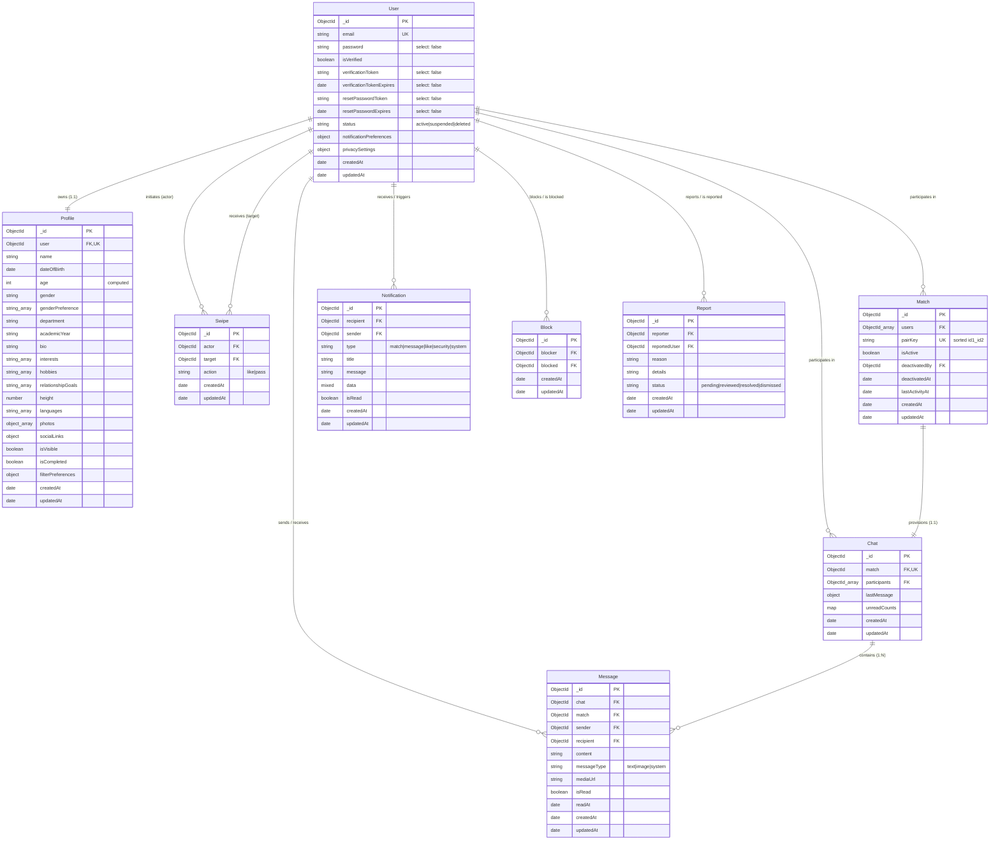

# WeDate — Database Schema & Data Models Documentation

This document provides a comprehensive reference for the data persistence layer of **WeDate**, built with **MongoDB** and **Mongoose 8**.

---

## 1. Entity-Relationship (ER) Diagram

The following diagram illustrates the relationships between all 9 collections in WeDate:

---

## 2. Models Deep Dive

### 2.1 User Model ([User.js](file:///c:/Users/AnayGore/OneDrive/Desktop/WeDate/server/src/models/User.js))

The `User` collection manages identity, authentication credentials, security tokens, account state, and notification/privacy configurations.

| Field Name | Type | Modifiers & Defaults | Description |
| :--- | :--- | :--- | :--- |
| `_id` | `ObjectId` | Auto-generated PK | MongoDB primary key. |
| `email` | `String` | `required`, `unique`, `lowercase`, `trim`, `index: true` | Verified student community email address. |
| `password` | `String` | `required`, `minlength: 8`, `select: false` | Bcrypt password hash (12 salt rounds). Never queried by default. |
| `isVerified` | `Boolean` | `default: false` | Indicates whether the student confirmed their email address. |
| `verificationToken` | `String` | `select: false` | SHA-256 hashed single-use email verification token. |
| `verificationTokenExpires`| `Date` | `select: false` | Expiration timestamp for email verification (24 hours). |
| `resetPasswordToken` | `String` | `select: false` | SHA-256 hashed single-use password recovery token. |
| `resetPasswordExpires` | `Date` | `select: false` | Expiration timestamp for password reset (1 hour). |
| `status` | `String` | `enum: ['active', 'suspended', 'deleted']`, `default: 'active'` | Operational status of the account. |
| `notificationPreferences` | `Object` | Nested schema | Student preferences for alerts: `newMatches`, `newMessages`, `profileLikes`, `emailAlerts` (all default `true`). |
| `privacySettings` | `Object` | Nested schema | Privacy controls: `profileVisibility` (default `true`), `personalizedRecommendations` (default `true`). |
| `timestamps` | `Date` | Managed automatically | `createdAt` and `updatedAt`. |

#### Schema Hooks & Methods
- **Pre-Save Hook**: Automatically checks if `password` was modified; if true, generates a 12-round salt and hashes the password before saving to the database.
- **`comparePassword(candidatePassword)`**: Compares a plaintext password against the stored bcrypt hash.
- **`createEmailVerificationToken()`**: Generates a 32-byte cryptographic random hex token, stores the SHA-256 hash on the document with a 24-hour expiration, and returns the raw plaintext token for the email link.
- **`createPasswordResetToken()`**: Generates a 32-byte cryptographic random hex token, stores the SHA-256 hash on the document with a 1-hour expiration, and returns the raw plaintext token for the recovery email.

---

### 2.2 Profile Model ([Profile.js](file:///c:/Users/AnayGore/OneDrive/Desktop/WeDate/server/src/models/Profile.js))

The `Profile` collection stores all public-facing student data, photos, academic background, personal preferences, and filter configurations.

| Field Name | Type | Modifiers & Defaults | Description |
| :--- | :--- | :--- | :--- |
| `user` | `ObjectId` | `ref: 'User'`, `required`, `unique`, `index: true` | Foreign key referencing the owning user record (1:1). |
| `name` | `String` | `required`, `trim`, `maxlength: 60` | Student's display name. |
| `dateOfBirth` | `Date` | `required` | Date of birth for age derivation and 18+ enforcement. |
| `age` | `Number` | `min: 18`, `index: true` | Computed age in years, calculated on validation. |
| `gender` | `String` | `enum: ['Woman', 'Man', 'Non-binary', 'Other']`, `required` | Gender identity. |
| `genderPreference` | `[String]` | `enum: ['Woman', 'Man', 'Non-binary', 'Everyone']`, `default: ['Everyone']` | Desired match gender pool. |
| `department` | `String` | `required`, `trim`, `index: true` | Academic major / field of study (e.g., Computer Science, Mechanical). |
| `academicYear` | `String` | `enum: ['First Year (FE)', 'Second Year (SE)', 'Third Year (TE)', 'Final Year (BE)', 'Postgraduate (PG)']`, `required`, `index: true` | Current academic standing. |
| `bio` | `String` | `trim`, `maxlength: 600`, `default: ''` | Freeform biographical text analyzed by TF-IDF engine. |
| `interests` | `[String]` | `default: []` | Academic and extracurricular interests (e.g., Artificial Intelligence, Open Source). |
| `hobbies` | `[String]` | `default: []` | Personal hobbies and recreational activities (e.g., Photography, Badminton). |
| `relationshipGoals`| `[String]` | `enum: RELATIONSHIP_GOALS`, `default: ['Open to exploring']` | Intentions on WeDate (e.g., Long-term, Casual dating, Study partner). |
| `height` | `Number` | `min: 100`, `max: 230`, `default: null` | Optional height in centimeters. |
| `languages` | `[String]` | `default: ['English']` | Spoken and regional languages. |
| `photos` | `[PhotoSchema]` | `default: []` | Array of photo objects containing `url`, `publicId`, `isPrimary`, and `caption`. |
| `socialLinks` | `Object` | Nested schema | Optional social media handles: `instagram`, `linkedin`, `spotify`. |
| `isVisible` | `Boolean` | `default: true`, `index: true` | Privacy toggle to pause discovery without account deletion. |
| `isCompleted` | `Boolean` | `default: false`, `index: true` | Status flag derived automatically when onboarding requirements are met. |
| `filterPreferences`| `Object` | Nested schema | Search criteria: `minAge`, `maxAge`, `genders`, `department`, `academicYear`. |
| `timestamps` | `Date` | Managed automatically | `createdAt` and `updatedAt`. |

#### Schema Hooks & Invariants
- **Pre-Validate Hook (Age Derivation)**: Automatically computes the student's exact age from `dateOfBirth` relative to the current server date before schema validation executes.
- **Pre-Validate Hook (Primary Photo Guarantee)**: Ensures that if at least one photo exists, exactly one is marked `isPrimary = true` (defaulting to the first uploaded photo).
- **Pre-Validate Hook (Completion Evaluation)**: Sets `isCompleted = true` if and only if:
  1. `name` is populated.
  2. `age >= 18`.
  3. `department` is specified.
  4. `academicYear` is selected.
  5. `photos.length >= 1`.

---

### 2.3 Swipe Model ([Swipe.js](file:///c:/Users/AnayGore/OneDrive/Desktop/WeDate/server/src/models/Swipe.js))

The `Swipe` collection captures unidirectional user evaluations (like or pass).

| Field Name | Type | Modifiers & Defaults | Description |
| :--- | :--- | :--- | :--- |
| `actor` | `ObjectId` | `ref: 'User'`, `required`, `index: true` | User initiating the swipe. |
| `target` | `ObjectId` | `ref: 'User'`, `required`, `index: true` | User whose profile is being evaluated. |
| `action` | `String` | `enum: ['like', 'pass']`, `required` | Evaluation choice. |
| `timestamps` | `Date` | Managed automatically | `createdAt` and `updatedAt`. |

#### Indexes
- **Compound Unique Index**: `{ actor: 1, target: 1 }` with `{ unique: true }`. Prevents a student from submitting duplicate swipes on the same candidate.

---

### 2.4 Match Model ([Match.js](file:///c:/Users/AnayGore/OneDrive/Desktop/WeDate/server/src/models/Match.js))

The `Match` collection represents a confirmed mutual connection between two students.

| Field Name | Type | Modifiers & Defaults | Description |
| :--- | :--- | :--- | :--- |
| `users` | `[ObjectId]` | `ref: 'User'`, `required` (exactly 2 elements) | The two matched participants. |
| `pairKey` | `String` | `required`, `unique`, `index: true` | Deterministic sorted pair string (e.g. `"${idA}_${idB}"` where `idA < idB`). |
| `isActive` | `Boolean` | `default: true`, `index: true` | Indicates if match is active. Set to `false` if un-matched or blocked. |
| `deactivatedBy` | `ObjectId` | `ref: 'User'`, `default: null` | User who initiated deactivation or block. |
| `deactivatedAt` | `Date` | `default: null` | Timestamp when the match was deactivated. |
| `lastActivityAt`| `Date` | `default: Date.now`, `index: true` | Timestamp of the most recent message or interaction. |
| `timestamps` | `Date` | Managed automatically | `createdAt` and `updatedAt`. |

#### Schema Hooks
- **Pre-Validate Hook (Canonical PairKey)**: Takes the two IDs in `users`, sorts them lexicographically, and sets `pairKey = "${sorted[0]}_${sorted[1]}"`. Guarantees database-level uniqueness regardless of who initiated the second swipe.

---

### 2.5 Chat Model ([Chat.js](file:///c:/Users/AnayGore/OneDrive/Desktop/WeDate/server/src/models/Chat.js))

The `Chat` collection represents the messaging channel tied to an active mutual match.

| Field Name | Type | Modifiers & Defaults | Description |
| :--- | :--- | :--- | :--- |
| `match` | `ObjectId` | `ref: 'Match'`, `required`, `unique`, `index: true` | 1:1 foreign key referencing the parent match. |
| `participants` | `[ObjectId]` | `ref: 'User'`, `required`, `index: true` | The two chat participants. |
| `lastMessage` | `Object` | Nested schema | Snapshot of latest message: `{ text, sender, createdAt, mediaUrl }`. |
| `unreadCounts` | `Map of Number`| `default: {}` | Key-value store mapping `userId -> unreadMessageCount`. |
| `timestamps` | `Date` | Managed automatically | `createdAt` and `updatedAt`. |

---

### 2.6 Message Model ([Message.js](file:///c:/Users/AnayGore/OneDrive/Desktop/WeDate/server/src/models/Message.js))

The `Message` collection stores individual messages transmitted between matched students.

| Field Name | Type | Modifiers & Defaults | Description |
| :--- | :--- | :--- | :--- |
| `chat` | `ObjectId` | `ref: 'Chat'`, `required`, `index: true` | Channel this message belongs to. |
| `match` | `ObjectId` | `ref: 'Match'`, `required`, `index: true` | Associated match. |
| `sender` | `ObjectId` | `ref: 'User'`, `required`, `index: true` | Author of the message. |
| `recipient` | `ObjectId` | `ref: 'User'`, `required`, `index: true` | Intended recipient. |
| `content` | `String` | `trim`, `maxlength: 2000`, `default: ''` | Message text content. |
| `messageType` | `String` | `enum: ['text', 'image', 'system']`, `default: 'text'` | Content type classification. |
| `mediaUrl` | `String` | `default: ''` | Cloudinary or local upload URL for shared images. |
| `isRead` | `Boolean` | `default: false`, `index: true` | Delivery and read receipt status. |
| `readAt` | `Date` | `default: null` | Timestamp when the recipient opened the message. |
| `timestamps` | `Date` | Managed automatically | `createdAt` and `updatedAt`. |

#### Indexes
- **Compound Index**: `{ chat: 1, createdAt: -1 }`. Enables rapid paginated retrieval of historical conversation logs in reverse-chronological order.

---

### 2.7 Notification Model ([Notification.js](file:///c:/Users/AnayGore/OneDrive/Desktop/WeDate/server/src/models/Notification.js))

The `Notification` collection captures in-app alerts dispatched to users.

| Field Name | Type | Modifiers & Defaults | Description |
| :--- | :--- | :--- | :--- |
| `recipient` | `ObjectId` | `ref: 'User'`, `required`, `index: true` | Target user receiving the alert. |
| `sender` | `ObjectId` | `ref: 'User'`, `default: null` | Actor who triggered the alert (if applicable). |
| `type` | `String` | `enum: ['match', 'message', 'like', 'security', 'system']`, `required` | Event classification. |
| `title` | `String` | `required` | Notification title string. |
| `message` | `String` | `required` | Notification body text. |
| `data` | `Mixed` | `default: {}` | Arbitrary JSON payload (e.g. `matchId`, `chatId`). |
| `isRead` | `Boolean` | `default: false`, `index: true` | Read state flag. |
| `timestamps` | `Date` | Managed automatically | `createdAt` and `updatedAt`. |

#### Indexes
- **Compound Index**: `{ recipient: 1, createdAt: -1 }`. Optimizes queries for a user's notification center feed.

---

### 2.8 Block Model ([Block.js](file:///c:/Users/AnayGore/OneDrive/Desktop/WeDate/server/src/models/Block.js))

The `Block` collection enforces mutual exclusion between students for trust and safety.

| Field Name | Type | Modifiers & Defaults | Description |
| :--- | :--- | :--- | :--- |
| `blocker` | `ObjectId` | `ref: 'User'`, `required`, `index: true` | User initiating the block. |
| `blocked` | `ObjectId` | `ref: 'User'`, `required`, `index: true` | User being blocked. |
| `timestamps` | `Date` | Managed automatically | `createdAt` and `updatedAt`. |

#### Indexes & Cascading Behavior
- **Compound Unique Index**: `{ blocker: 1, blocked: 1 }` with `{ unique: true }`.
- **Match Deactivation**: When a block is created, [safetyService.js](file:///c:/Users/AnayGore/OneDrive/Desktop/WeDate/server/src/services/safetyService.js) automatically finds any existing `Match` between the two users via their `pairKey` and sets `isActive = false`, terminating active socket chat sessions.

---

### 2.9 Report Model ([Report.js](file:///c:/Users/AnayGore/OneDrive/Desktop/WeDate/server/src/models/Report.js))

The `Report` collection stores abuse reports submitted to the student moderation queue.

| Field Name | Type | Modifiers & Defaults | Description |
| :--- | :--- | :--- | :--- |
| `reporter` | `ObjectId` | `ref: 'User'`, `required`, `index: true` | Student reporting the incident. |
| `reportedUser`| `ObjectId` | `ref: 'User'`, `required`, `index: true` | Account being reported. |
| `reason` | `String` | `required`, `enum: [...]` | Categorized infraction: `'Harassment or bullying'`, `'Inappropriate or explicit photos'`, `'Spam or commercial promotion'`, `'Fake profile or impersonation'`, `'Underage user'`, `'Hate speech'`, `'Other safety concern'`. |
| `details` | `String` | `trim`, `maxlength: 1000`, `default: ''` | Specific incident narrative. |
| `status` | `String` | `enum: ['pending', 'reviewed', 'resolved', 'dismissed']`, `default: 'pending'`, `index: true` | Moderation queue review state. |
| `timestamps` | `Date` | Managed automatically | `createdAt` and `updatedAt`. |

#### Indexes
- **Compound Index**: `{ reporter: 1, reportedUser: 1, createdAt: -1 }`. Prevents repeated abuse submission flooding and aids moderator audit trails.

---

## 3. Database Indexes Summary Table

| Collection | Index Keys | Type / Properties | Primary Optimization Goal |
| :--- | :--- | :--- | :--- |
| **User** | `{ email: 1 }` | Unique | Instant login and registration uniqueness checks. |
| **Profile** | `{ user: 1 }` | Unique | 1:1 foreign key lookups between session and profile data. |
| **Profile** | `{ isVisible: 1, isCompleted: 1 }` | Compound | Fast discovery candidate filtering. |
| **Profile** | `{ age: 1 }` | Single-field | Range queries for user age filter preferences. |
| **Profile** | `{ department: 1, academicYear: 1 }` | Compound | Academic affinity lookups and discovery filters. |
| **Swipe** | `{ actor: 1, target: 1 }` | Compound Unique | Duplicate swipe prevention & instantaneous swipe verification. |
| **Swipe** | `{ actor: 1 }`, `{ target: 1 }` | Single-field | Reciprocal like detection and exclusion list construction. |
| **Match** | `{ pairKey: 1 }` | Unique | Idempotent match creation and lightning-fast match lookups. |
| **Match** | `{ users: 1, isActive: 1 }` | Compound | Fetching active matches for a student. |
| **Match** | `{ lastActivityAt: -1 }` | Single-field | Sorting conversation lists by latest message timestamp. |
| **Chat** | `{ match: 1 }` | Unique | 1:1 pairing between Match and Chat channel. |
| **Chat** | `{ participants: 1 }` | Multikey | Finding all active conversation threads for a given student. |
| **Message** | `{ chat: 1, createdAt: -1 }` | Compound | Reverse-chronological chat history paging. |
| **Notification** | `{ recipient: 1, createdAt: -1 }` | Compound | Fetching student notifications sorted by arrival time. |
| **Block** | `{ blocker: 1, blocked: 1 }` | Compound Unique | Preventing duplicate block actions and ensuring fast exclusion queries. |
| **Report** | `{ reporter: 1, reportedUser: 1, createdAt: -1 }` | Compound | Moderator dashboard query optimization and abuse tracking. |

---

## 4. Connection Architecture & Embedded Memory Server

WeDate implements a zero-friction dual database strategy configured in [db.js](file:///c:/Users/AnayGore/OneDrive/Desktop/WeDate/server/src/config/db.js):

1. **Production & Staging**: Connects to MongoDB Atlas or local MongoDB instance specified via `MONGODB_URI` with a 5-second connection timeout (`serverSelectionTimeoutMS: 5000`).
2. **Development & Testing Fallback**: If `MONGODB_URI` is unset or unavailable, the application dynamically starts an embedded `MongoMemoryServer` (via `mongodb-memory-server` 10). This permits instant local development and deterministic Jest test execution without requiring any external database daemon.
