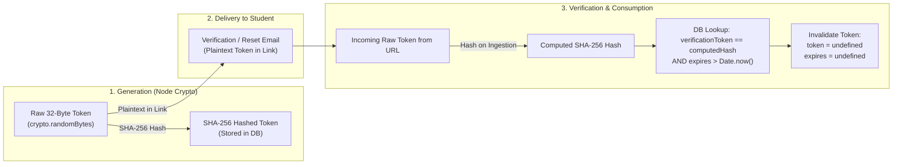
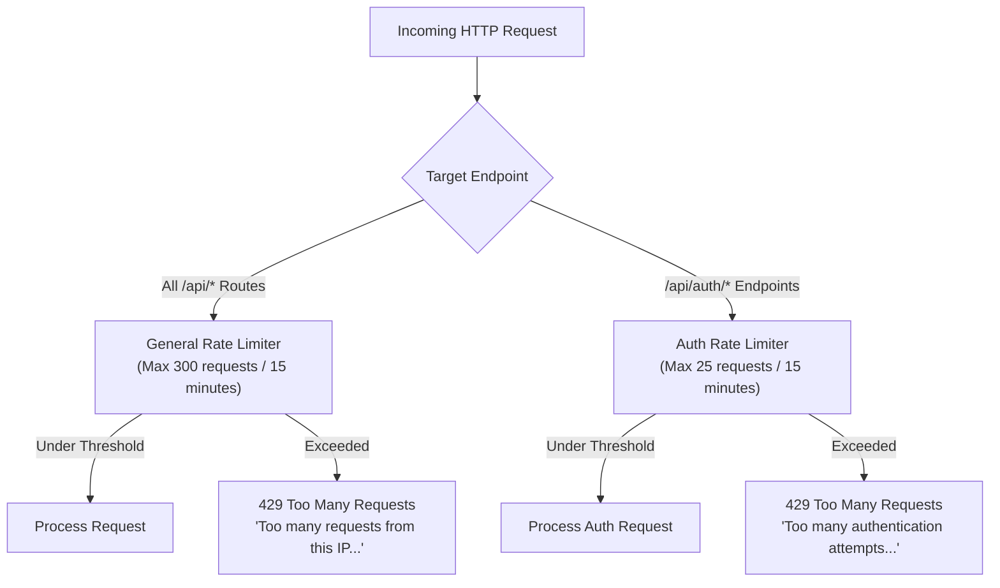

# WeDate — Security Architecture & Best Practices

Trust and student safety form the foundation of **WeDate**. This document outlines the defense-in-depth security model implemented across the client application, API gateway, authentication layer, media pipeline, database, and real-time communication engine.

---

## 1. Security Architecture Matrix

| Security Layer | Primary Mechanism | Implementation Detail | Threat Mitigated |
| :--- | :--- | :--- | :--- |
| **Identity Verification** | Student Domain Whitelisting | `ALLOWED_EMAIL_DOMAIN` environment enforcement | Impersonation, unauthorized outside actors, automated bot registrations. |
| **Credential Storage** | `bcryptjs` Hashing | 12 salt rounds, slow adaptive key derivation | Credential theft via database dumps, rainbow table attacks. |
| **Session Management** | JSON Web Tokens (JWT) | Dual support: `httpOnly` secure cookies + `Bearer` tokens | Cross-Site Scripting (XSS) token extraction, session hijacking. |
| **API Boundary** | Helmet HTTP Headers | `crossOriginResourcePolicy`, MIME sniffing prevention, XSS filter | Clickjacking, MIME confusion, unauthorized cross-origin framing. |
| **Cross-Origin Control**| CORS Policies | Whitelisted origin validation, explicit allowed headers and methods | Unauthorized third-party cross-site request execution. |
| **DDoS & Brute-Force** | IP Rate Limiting | Dual rate limiters: General (300/15m), Auth (25/15m) | Credential stuffing, brute-force login attacks, resource exhaustion. |
| **Input Validation** | Zod & Mongoose Validation | Compile-time & runtime schema parsing, strict type checks | SQL/NoSQL injection, prototype pollution, malformed payloads. |
| **Media Uploads** | Multer In-Memory Buffer | 5MB ceiling, strict image MIME whitelist (`jpeg`, `png`, `webp`) | Remote code execution (RCE), malicious file uploads, disk flooding. |
| **Account Recovery** | Crypto SHA-256 Hashing | Single-use expiring random hex tokens (Node.js `crypto`) | Account takeover, token replay attacks, token leakage in logs. |
| **Data Privacy** | Query Field Exclusion | `select: false` on password and token fields | Accidental credential leakage in REST endpoints or debug logs. |
| **Real-Time Security**| Socket.IO Handshake Auth | JWT verification during WebSocket handshake | Unauthorized eavesdropping or spoofing of student chat events. |
| **Trust & Safety** | Mutual Block & Moderation | Cascade match deactivation, mutual feed exclusion, abuse queue | Harassment, stalking, inappropriate content dissemination. |

---

## 2. Authentication & Credential Security

### 2.1 Password Hashing with bcryptjs
WeDate enforces modern cryptographic storage standards using `bcryptjs`:
- **Adaptive Cost Factor**: Configured to 12 salt rounds (`bcrypt.genSalt(12)`), requiring significant computational work to compute hashes, effectively neutralizing offline dictionary and GPU rainbow table attacks.
- **Pre-Save Automation**: Implemented via a Mongoose pre-save hook in [User.js](file:///c:/Users/AnayGore/OneDrive/Desktop/WeDate/server/src/models/User.js#L62-L68):
  ```javascript
  userSchema.pre('save', async function (next) {
    if (!this.isModified('password')) return next();
    const salt = await bcrypt.genSalt(12);
    this.password = await bcrypt.hash(this.password, salt);
    next();
  });
  ```
- **Query Exclusion**: The `password` field is configured with `select: false` in the Mongoose schema. Standard `User.find()` or `User.findOne()` calls will never return the hash unless explicitly requested with `.select('+password')` during credential validation.

---

### 2.2 Student Email Domain Guard (`ALLOWED_EMAIL_DOMAIN`)
To maintain an exclusive, verified student community, registration requests are validated against the `ALLOWED_EMAIL_DOMAIN` environment variable in [authService.js](file:///c:/Users/AnayGore/OneDrive/Desktop/WeDate/server/src/services/authService.js#L7-L17):
- Evaluates the host portion of the student email address.
- Allows subdomain matching (e.g., student accounts ending in `.campus.edu`).
- Rejects personal webmail accounts (e.g., Gmail, Yahoo, Outlook) before any database operations occur:
  ```javascript
  export const isAllowedEmailDomain = (email = '') => {
    const allowedDomain = process.env.ALLOWED_EMAIL_DOMAIN || 'campus.edu';
    if (!allowedDomain || allowedDomain === '*') return true;
    const normalized = email.trim().toLowerCase();
    const domainPart = normalized.split('@')[1];
    if (!domainPart) return false;
    const cleanAllowed = allowedDomain.trim().toLowerCase().replace(/^@/, '');
    return domainPart === cleanAllowed || domainPart.endsWith(`.${cleanAllowed}`);
  };
  ```

---

### 2.3 Single-Use Cryptographic Tokens (Verification & Password Reset)
Account verification and password recovery use cryptographically secure pseudo-random tokens generated with Node.js built-in `crypto.randomBytes(32)`:



1. **Storage Security**: Only the SHA-256 hash of the token is persisted in MongoDB. If the database is compromised, the stored hashes cannot be reversed to forge valid links.
2. **Short Time-to-Live (TTL)**:
   - Email Verification Tokens: 24-hour expiration (`verificationTokenExpires = Date.now() + 24 * 60 * 60 * 1000`).
   - Password Reset Tokens: 1-hour expiration (`resetPasswordExpires = Date.now() + 60 * 60 * 1000`).
3. **Single-Use Consumption**: Upon successful verification or password reset, the token and expiration fields are immediately cleared (`undefined`) in the database, preventing token replay attacks.

---

### 2.4 JWT Session Architecture & Dual Storage
Authentication sessions use signed JSON Web Tokens (`jsonwebtoken`) managed in [jwt.js](file:///c:/Users/AnayGore/OneDrive/Desktop/WeDate/server/src/config/jwt.js) and [auth.js](file:///c:/Users/AnayGore/OneDrive/Desktop/WeDate/server/src/middleware/auth.js):
- **Claims**: Tokens contain only non-sensitive identifiers (`userId`, `email`).
- **Signature Expiry**: Set to 7 days by default (`JWT_EXPIRES_IN=7d`).
- **Dual Extraction**: The server accepts the token via:
  1. `Authorization: Bearer <token>` HTTP header (standard for SPA REST and automated tests).
  2. `token` cookie with security attributes:
     - `httpOnly: true`: Prevents client-side scripts from reading the cookie, neutralizing cross-site scripting (XSS) token theft.
     - `secure: true` (in production): Ensures cookies are transmitted solely over TLS/HTTPS.
     - `sameSite: 'none'` (cross-site production) / `sameSite: 'lax'` (local development): Defends against Cross-Site Request Forgery (CSRF).

---

## 3. Network & Transport Security

### 3.1 HTTP Header Hardening (Helmet 8)
WeDate integrates [Helmet](https://helmetjs.github.io/) in [app.js](file:///c:/Users/AnayGore/OneDrive/Desktop/WeDate/server/src/app.js#L28-L32):
- **Cross-Origin Resource Policy (CORP)**: Configured as `cross-origin` to enable client image loading from Cloudinary and local media endpoints.
- **X-DNS-Prefetch-Control**: Disables DNS prefetching to protect user browsing privacy.
- **X-Frame-Options**: Defaults to `SAMEORIGIN`, preventing unauthorized framing and clickjacking attacks.
- **X-Content-Type-Options**: Enforces `nosniff`, preventing browsers from MIME-sniffing file uploads away from their declared content type.

---

### 3.2 Cross-Origin Resource Sharing (CORS)
Configured to support both the Vite client application and authenticated WebSocket handshakes:
- Explicit allowed origins: validates against `process.env.CLIENT_URL` (default: `http://localhost:5173`).
- Permitted HTTP verbs: `GET`, `POST`, `PUT`, `PATCH`, `DELETE`, `OPTIONS`.
- Permitted HTTP headers: `Content-Type`, `Authorization`.
- Credentials enabled: `credentials: true` allows browser cookie transmission across authenticated endpoints.

---

### 3.3 Rate Limiting & Throttling
WeDate applies granular, IP-based request throttling using `express-rate-limit` in [rateLimiter.js](file:///c:/Users/AnayGore/OneDrive/Desktop/WeDate/server/src/middleware/rateLimiter.js):



1. **General API Limiter**: Applied globally across all `/api` endpoints:
   - Window: 15 minutes (`15 * 60 * 1000`).
   - Threshold: Maximum 300 requests per IP address.
   - Headers: Returns standard RFC headers (`RateLimit-Limit`, `RateLimit-Remaining`, `RateLimit-Reset`).
2. **Authentication Limiter**: Applied specifically to brute-force targets (`/api/auth/register`, `/api/auth/login`, `/api/auth/forgot-password`, `/api/auth/reset-password`):
   - Window: 15 minutes.
   - Threshold: Strict limit of 25 attempts per IP address.

---

## 4. Input Sanitization & Upload Safeguards

### 4.1 Input Validation with Zod & Mongoose
All data inputs are subject to two layers of structural validation:
1. **Schema Validation**: Mongoose enforces strong types, required constraints, string lengths (e.g., bio maximum 600 characters, message maximum 2000 characters, name maximum 60 characters), and enum validation (genders, academic years, relationship goals).
2. **Type Coercion & Sanitization**: Incoming strings are trimmed of leading/trailing whitespace, emails are lowercased, and dates are strictly parsed before age calculation.

---

### 4.2 Multipart File Upload Restrictions
Student photo uploads are handled via Multer and validated in [upload.js](file:///c:/Users/AnayGore/OneDrive/Desktop/WeDate/server/src/middleware/upload.js):
- **Memory Storage**: Files are kept in ephemeral memory buffers (`multer.memoryStorage()`) rather than written to disk before validation, preventing malicious executable persistence.
- **Strict Size Limit**: Capped at **5 MB** (`5 * 1024 * 1024` bytes). Exceeding files trigger a clean 400 Bad Request error handled by [errorHandler.js](file:///c:/Users/AnayGore/OneDrive/Desktop/WeDate/server/src/middleware/errorHandler.js#L39-L44).
- **MIME Type Whitelist**: Accepts only safe image types:
  - `image/jpeg`
  - `image/png`
  - `image/webp`
  - `image/jpg`
- Rejects executable files, scripts, SVG (to avoid SVG-based stored XSS), and unexpected binary attachments.

---

## 5. Real-Time Socket.IO Security

WebSocket connections are authenticated before the connection is accepted in [chatSocket.js](file:///c:/Users/AnayGore/OneDrive/Desktop/WeDate/server/src/sockets/chatSocket.js#L11-L33):

```javascript
io.use((socket, next) => {
  const token =
    socket.handshake.auth?.token ||
    socket.handshake.headers?.authorization?.split(' ')[1] ||
    socket.handshake.query?.token;

  if (!token) {
    return next(new Error('Authentication required for real-time socket.'));
  }

  const decoded = verifyToken(token);
  if (!decoded || !decoded.userId) {
    return next(new Error('Invalid or expired socket token.'));
  }

  socket.userId = decoded.userId.toString();
  next();
});
```

### Channel Authorization & Mutual Match Guard
Students cannot arbitrarily join rooms:
- **`join_chat` Authorization**: When a client requests to join `chat:<chatId>`, the server verifies in MongoDB that:
  1. The student's `userId` is present in `chat.participants`.
  2. The parent `Match` document exists and has `isActive === true`.
  3. No active block exists between the participants.
- If any check fails, the join request is rejected and no socket traffic is forwarded.

---

## 6. Trust, Safety & Privacy Protections

### 6.1 Mutual Block Enforcement
When a student blocks another user via `/api/users/:userId/block`:
1. **Permanent Exclusion**: A unique compound record `{ blocker: id1, blocked: id2 }` is persisted in the `Block` collection.
2. **Cascade Match Deactivation**: Any existing `Match` between the two students is updated to `isActive: false`, terminating real-time communication.
3. **Feed Filtering**: The discovery engine automatically excludes all profiles belonging to users who have blocked, or have been blocked by, the requesting student.

---

### 6.2 Student Moderation & Reporting
The reporting system ([Report.js](file:///c:/Users/AnayGore/OneDrive/Desktop/WeDate/server/src/models/Report.js)) categorizes student concerns into 7 defined policy categories:
- Harassment or bullying
- Inappropriate or explicit photos
- Spam or commercial promotion
- Fake profile or impersonation
- Underage user
- Hate speech
- Other safety concern

Reports are captured with timestamps, audit details, and initial `pending` status for community moderation review.

---

### 6.3 Sensitive Data Protection & Profile Visibility
- **No Password or Token Exposure**: Passwords and cryptographic tokens are never included in API responses or profile DTOs.
- **Privacy Controls**: Students can toggle `privacySettings.profileVisibility = false` in their settings to immediately hide their card from the discovery feed without losing matches or chat histories.
- **Personalization Opt-Out**: Students can toggle `privacySettings.personalizedRecommendations = false` to switch from AI-scored recommendations to standard baseline chronological discovery.
