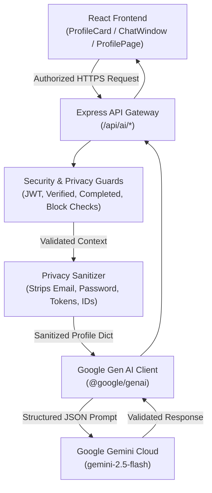

# WeDate Smart Connection Assistant — Generative AI Integration

## Overview

The **Smart Connection Assistant** is a privacy-first, genuinely generative AI capability integrated into WeDate using the official Google Gen AI SDK (`@google/genai`) and the **Gemini 2.5 Flash** model.

It enhances WeDate with four collegiate social connection capabilities:
1. **Smart Discovery Synergy**: Evaluates subtle compatibility and conversational potential across voluntary profile data.
2. **Grounded Personalized Explanations**: Generates transparent, 2-3 sentence explanations detailing why two students share affinity, referencing exclusively verified profile attributes.
3. **Mutual-Match Conversation Starters**: Generates 3 natural, non-cringe icebreakers for students who have reciprocally matched, grounded in mutual passions or profile details.
4. **Voice-Preserving Bio Coach**: Suggests 3 tailored variations of a student's biography (Authentic, Story-driven, Concise) while strictly preserving their authentic voice and factual accuracy.

---

## Architecture & Data Flow



---

## Core Capabilities

### 1. Grounded Personalized Explanations (`POST /api/ai/explain`)
- **Purpose**: Gives students deeper context on why a profile appeared in their discovery deck.
- **Rules**: Every claim must link directly to an explicit interest, hobby, department, academic year, or biography snippet.
- **Output Schema**:
  ```json
  {
    "explanation": "You both share a passion for coding and indie music, and your relationship goals align closely.",
    "sharedHighlights": ["Coding", "Indie Music", "Long-term relationship"],
    "conversationSpark": "Ask about their favorite acoustic guitar jamming spots near the campus library."
  }
  ```

### 2. Mutual-Match Conversation Starters (`POST /api/ai/icebreakers`)
- **Strict Authorization**: Only accessible for active, confirmed mutual matches (`Match.users` contains both users and `isActive: true`).
- **Safety**: Automatically rejected if either user has blocked the other.
- **Output Schema**:
  ```json
  {
    "partnerName": "Ananya Deshmukh",
    "starters": [
      {
        "category": "Shared Passion",
        "starter": "Hey Ananya! Saw you're into cafe hopping around Bandra — know any quiet spots near campus with good cold brew?",
        "rationale": "Both users enjoy cafe hopping and reading."
      }
    ]
  }
  ```

### 3. Voice-Preserving Bio Coach (`POST /api/ai/enhance-bio`)
- **Purpose**: Helps students draft authentic, engaging biographies.
- **Integrity Guarantee**: Never invents fake sports, false achievements, or unmentioned hobbies.
- **3 Tonal Options**:
  1. *Authentic & Conversational*: Natural, approachable, easy to message.
  2. *Engaging & Story-driven*: Vivid, lifestyle-focused.
  3. *Concise & Expressive*: Punchy, witty, and direct.

---

## Privacy & Security Architecture

1. **Server-Side API Key Storage**: The `GEMINI_API_KEY` is exclusively managed via server-side environment variables and is never transmitted to or accessible by client code.
2. **Strict Attribute Sanitization**:
   ```javascript
   // Only voluntary public fields are forwarded to the model:
   {
     name,
     department,
     academicYear,
     bio,
     interests,
     hobbies,
     relationshipGoals,
     languages
   }
   // Stripped: email, password hash, verification tokens, reset tokens, internal MongoDB IDs, private messages
   ```
3. **No Private Messages Forwarded**: Conversation starters analyze public profile interests, never historical private chat logs.
4. **Reciprocal Block Enforcement**: If User A has blocked User B (or vice versa), all AI synergy, explanation, and starter endpoints return `403 Forbidden`.
5. **AI Rate Limiting**: The `/api/ai/*` route group is shielded by a dedicated rate limiter (`35 requests per 15 minutes per IP`) preventing token quota exhaustion.
6. **No Fake Responses**: If `GEMINI_API_KEY` is unconfigured, the system returns `{ success: false, code: 'AI_NOT_CONFIGURED' }` and the UI gracefully informs the user without pretending the model responded.

---

## Configuration & Setup

### 1. Obtain a Free Gemini API Key
Visit Google AI Studio: [https://aistudio.google.com/](https://aistudio.google.com/) and create a free API key.

### 2. Configure Environment Variable
Add the following to your root `.env` or `server/.env`:

```env
# Google Gemini Generative AI
GEMINI_API_KEY=your_actual_gemini_api_key_here
GEMINI_MODEL=gemini-2.5-flash
```

### 3. Start Application
```bash
npm run dev
```

---

## Testing & Verification

### Automated Jest Tests
WeDate includes automated tests covering privacy sanitization, block guards, match authorization, and error handling:

```bash
npm --prefix server test tests/aiAssistant.test.js
```

### Manual Testing Scenarios

1. **Test Icebreakers in Live Chat**:
   - Log in as `aarav.sharma@campus.edu` (Password: `WeDatePass123!`).
   - Navigate to **Matches & Chat** and click the mutual match with **Ananya Deshmukh**.
   - Click the **"✨ AI Icebreakers"** button above the message input.
   - Observe the 3 grounded conversation starters. Click any starter to auto-fill the chat input box!

2. **Test Deep Connection Insight in Discovery**:
   - Navigate to **Discover**.
   - On any profile card, scroll to the **WeDate Smart Discovery** card.
   - Click **"✨ Gemini Deep Connection Insight"**.
   - Observe the grounded 2-3 sentence synergy explanation and shared highlight tags.

3. **Test Bio Coach in Profile Management**:
   - Navigate to **Profile**.
   - In the **Biography** section, click **"✨ Polish with AI Coach"**.
   - Review the 3 tonal variations and click **"Use This Bio"** to apply a suggestion.
