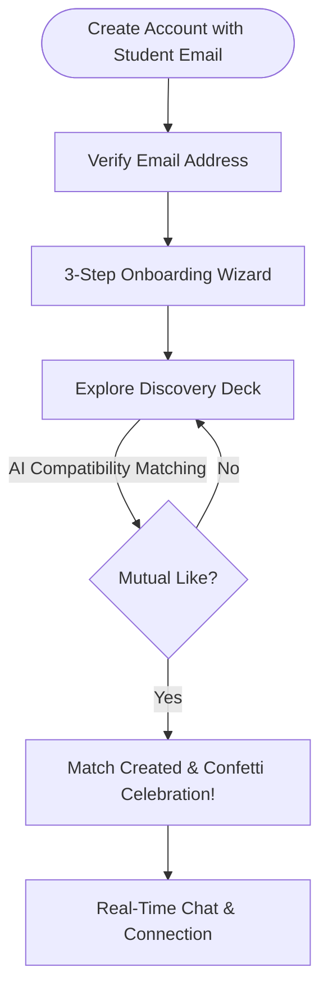
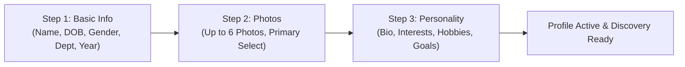
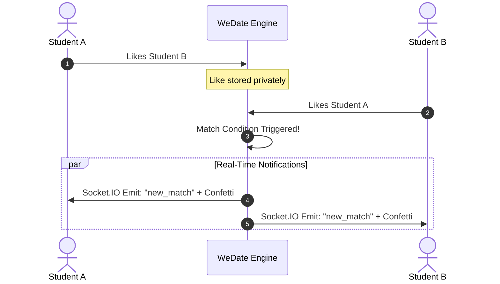
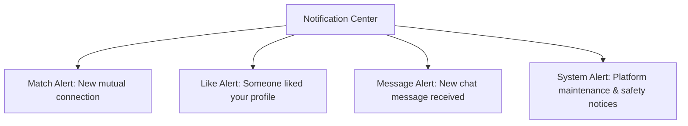
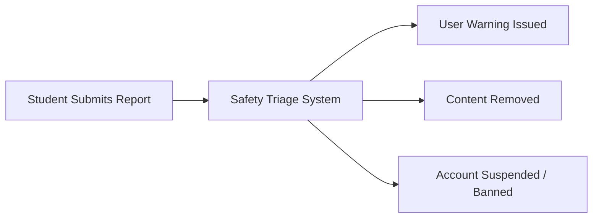

# WeDate User Guide

Welcome to **WeDate**, the premier AI-powered dating and social connection platform built exclusively for verified student communities. WeDate combines intelligent compatibility matching, real-time messaging, and verified campus credentials to create a fun, safe, and authentic dating experience tailored to university life.

---

## Table of Contents
1. [Getting Started](#getting-started)
   - [Eligibility & Requirements](#eligibility--requirements)
   - [Registration](#registration)
   - [Email Verification](#email-verification)
   - [Password Standards](#password-standards)
2. [Setting Up Your Profile (Onboarding)](#setting-up-your-profile-onboarding)
   - [Step 1: Basic Information](#step-1-basic-information)
   - [Step 2: Profile Photos](#step-2-profile-photos)
   - [Step 3: Personality & Lifestyle](#step-3-personality--lifestyle)
3. [Discovering People](#discovering-people)
   - [The Discovery Deck](#the-discovery-deck)
   - [AI Smart Badge & Recommendation Explanations](#ai-smart-badge--recommendation-explanations)
   - [Discovery Filters](#discovery-filters)
   - [Navigation & Swiping Controls](#navigation--swiping-controls)
4. [Matches](#matches)
   - [How Mutual Matching Works](#how-mutual-matching-works)
   - [Match Celebrations & Alerts](#match-celebrations--alerts)
   - [Managing Your Matches](#managing-your-matches)
   - [Unmatching](#unmatching)
5. [Messaging & Real-Time Chat](#messaging--real-time-chat)
   - [Real-Time Chat Engine](#real-time-chat-engine)
   - [Chat Features & Presence](#chat-features--presence)
   - [Conversations List](#conversations-list)
   - [In-Chat Safety Actions](#in-chat-safety-actions)
6. [Notifications](#notifications)
   - [Notification Types](#notification-types)
   - [Notification Center](#notification-center)
7. [Profile Management](#profile-management)
   - [Editing Your Details](#editing-your-details)
   - [Photo Gallery Management](#photo-gallery-management)
   - [Discovery Visibility Toggle](#discovery-visibility-toggle)
8. [Settings & Privacy](#settings--privacy)
   - [Account & Security](#1-account--security)
   - [Smart Discovery](#2-smart-discovery)
   - [Notification Preferences](#3-notifications)
   - [Blocked Users](#4-blocked-users)
   - [Account Deletion](#deleting-your-account)
9. [Safety Features & Community Guidelines](#safety-features--community-guidelines)
   - [Blocking & Reporting](#blocking-and-reporting)
   - [Campus Dating Safety Tips](#campus-dating-safety-tips)
10. [Demo Accounts](#demo-accounts)
    - [Testing Persona Matrix](#testing-persona-matrix)
    - [Quick-Start Demo Credentials](#quick-start-demo-credentials)
11. [Frequently Asked Questions (FAQ)](#frequently-asked-questions-faq)

---



---

## Getting Started

### Eligibility & Requirements
WeDate is designed specifically for students within a verified student community. To join the platform, every member must meet the following criteria:

* **Verified Student Email:** You must possess an active, valid student email address matching the domain configured by the community environment (e.g., `@campus.edu`, configured via the system's `ALLOWED_EMAIL_DOMAIN` setting).
* **Age Requirement:** You must be at least **18 years of age** or older at the time of registration. Your date of birth is validated during signup.
* **Single Student Profile:** Only one active profile is permitted per student email address.

> [!IMPORTANT]
> Non-student email domains (such as `@gmail.com`, `@yahoo.com`, or `@outlook.com`) are automatically rejected by the registration system to ensure a 100% verified campus ecosystem.

---

### Registration
1. Navigate to the WeDate home page and click **Get Started** or **Sign Up**.
2. Enter your **First Name**, **Last Name**, and your **verified student email address**.
3. Choose a secure password and confirm it.
4. Input your **Date of Birth** to verify that you are 18+.
5. Agree to the **Community Guidelines & Terms of Service**.
6. Click **Create Account**.

---

### Email Verification
To confirm your identity as an enrolled member of the verified student community, an activation email is dispatched immediately upon registration:

1. Open your student webmail inbox.
2. Locate the email from **WeDate Verification** with the subject `Verify your WeDate account`.
3. Click the **Verify Email** button or copy-paste the provided link into your browser.
4. Once verified, your status updates to active and you will be routed automatically to the **Profile Onboarding Wizard**.

> [!NOTE]
> **Developer / Local Environment Note:** When running WeDate in a development environment without an active third-party SMTP provider, the activation link and token are printed directly to the backend server console. Simply copy the link from the console output to complete verification.

---

### Password Standards
To safeguard student accounts, passwords must satisfy the following security standards:
* Minimum **8 characters** in length.
* At least **one uppercase letter** (`A-Z`).
* At least **one lowercase letter** (`a-z`).
* At least **one numeric digit** (`0-9`).
* At least **one special character** (e.g., `@`, `$`, `!`, `%`, `*`, `?`, `&`).

> [!TIP]
> Avoid using common campus passwords, your student ID number, or names of academic departments in your password.

---

## Setting Up Your Profile (Onboarding)

Once your email is verified, WeDate presents a smooth **3-step onboarding wizard**. Completing these steps ensures the AI recommendation engine can pair you with compatible students across campus.



---

### Step 1: Basic Information
This step establishes your foundational student profile:
* **Display Name:** Pre-populated from registration; editable if you prefer a nickname.
* **Date of Birth & Age:** Your birth date is used to calculate your age display. Your exact birthdate is kept private.
* **Gender Identity:** Select your gender (e.g., *Man*, *Woman*, *Non-Binary*, or *Prefer not to say*).
* **Gender Preference:** Choose whose profiles you would like to see in Discovery (*Men*, *Women*, or *Everyone*).
* **Academic Department:** Select your major or department (e.g., *Computer Science*, *Business Administration*, *Biomedical Engineering*, *Psychology*, *Fine Arts*).
* **Academic Year:** Select your current level:
  * *Freshman (1st Year)*
  * *Sophomore (2nd Year)*
  * *Junior (3rd Year)*
  * *Senior (4th Year)*
  * *Graduate / Master's*
  * *Doctoral / Ph.D.*

---

### Step 2: Profile Photos
Visual authenticity builds trust in student dating. WeDate allows you to showcase your campus life with up to **6 photos**.

* **Photo Limit:** Maximum of 6 high-resolution photos.
* **File Size:** Up to **5 MB per photo**.
* **Supported Formats:** `.jpg`, `.jpeg`, `.png`, and `.webp`.
* **Primary Photo:** Tap the star icon on any uploaded photo to set it as your **Primary Photo**. This is the lead photo displayed on your discovery card across campus.

> [!TIP]
> **Photo Tips for Students:**
> - Set a clear, well-lit headshot as your primary photo where your face is easily visible without sunglasses.
> - Include photos of you engaged in your favorite campus activities—studying at the library cafe, playing intramural sports, or exploring campus events.
> - Avoid group photos as your primary image so other students know immediately who you are.

---

### Step 3: Personality & Lifestyle
Let your authentic self shine so the AI recommendation engine can highlight meaningful shared passions:

* **Bio:** A short introduction (up to 500 characters). Share what excites you, what classes you're enjoying, your favorite coffee spot, or what you're looking for.
* **Interests (Multi-Select Chips):** Choose from curated categories like *Coding*, *Indie Music*, *Coffee Brewing*, *Hiking*, *Anime*, *Film Photography*, *Fitness*, *Board Games*, and more.
* **Hobbies (Multi-Select Chips):** Select activities you spend free time on, such as *Campus Running*, *Graphic Design*, *Baking*, *Podcasting*, or *Hackathons*.
* **Relationship Goals:** Be clear about your intentions:
  * *Long-Term Relationship*
  * *Short-Term / Casual Dating*
  * *Study Partner & Dating*
  * *Friends First*
  * *Open to Possibilities*
* **Height (Optional):** Enter your height if you would like it displayed on your profile.
* **Languages Spoken:** Multi-select all languages you speak comfortably (e.g., *English*, *Spanish*, *Hindi*, *Mandarin*, *French*).

Click **Complete Profile** to finalize onboarding and unlock the Discovery deck!

---

## Discovering People

The **Discovery** tab is the heart of WeDate. Here, you can browse verified students in your community through an interactive card deck.

```
+-------------------------------------------------------+
|  [Photo 1/4]                                          |
|                                                       |
|                     [PHOTO]                           |
|                                                       |
|  Aarav, 21                                            |
|  Computer Science * Senior                            |
|  --------------------------------------------------   |
|  [ AI Match: 96% | Shared: Hackathons, Indie Music ]  |
|  --------------------------------------------------   |
|  "Looking for someone to grab matcha and talk AI."    |
|                                                       |
|  [ X Pass (<-) ]                 [ <3 Like (->) ]     |
+-------------------------------------------------------+
```

### The Discovery Deck
* **Full Profile Cards:** Each card displays the student's primary image, full name, age, academic department, academic year, and compatibility details.
* **Photo Gallery Navigation:** 
  * Tap or click the left or right side of a photo to flip through all uploaded pictures.
  * Use the on-screen thumbnail dots or arrow icons to inspect individual images.
* **Expandable Bio & Details:** Scroll down on the card to inspect the student's full bio, relationship goals, height, spoken languages, and full chip lists for interests and hobbies.

---

### AI Smart Badge & Recommendation Explanations
Every profile card is analyzed in real time by WeDate's content-based AI engine:

* **Smart Match Score Badge:** Shows a percentage compatibility score (e.g., `94% Match`).
* **Explainable AI Highlights:** Provides explicit reasons for the match score, such as:
  * *"Both enjoy Coding & Hackathons"*
  * *"Same department: Computer Science"*
  * *"Shared relationship goal: Long-term relationship"*
  * *"Speaks common languages: English, Hindi"*

> [!NOTE]
> The AI recommendation engine calculates vector similarity across interests, hobbies, relationship goals, and academic alignments. You can enable or disable personalized scoring anytime in [Settings & Privacy](#settings--privacy).

---

### Discovery Filters
Tailor your card deck to fit your exact dating preferences. Tap the **Filter** icon at the top right of Discovery to adjust:

| Filter Option | Description |
| :--- | :--- |
| **Age Range** | Set minimum and maximum age sliders (e.g., 19 to 24). |
| **Gender Preference** | Choose to view Men, Women, Non-Binary, or All genders. |
| **Academic Department** | Narrow your view to students within your own department or explore others. |
| **Academic Year** | Filter by class standing (Freshmen, Sophomores, Juniors, Seniors, Postgrads). |
| **Interests Filter** | Prioritize students who share specific tags (e.g., *Fitness* or *Gaming*). |

---

### Navigation & Swiping Controls
You can navigate cards using either the intuitive on-screen buttons or keyboard shortcuts:

* **Pass (Skip):**
  * Click the circular **X (Pass)** button, or
  * Press the **Left Arrow (`←`)** on your keyboard.
* **Like (Connect):**
  * Click the circular **Heart (Like)** button, or
  * Press the **Right Arrow (`→`)** on your keyboard.

> [!TIP]
> If you are on a laptop during a study session, the **Left (`←`)** and **Right (`→`)** arrow keys provide a seamless, ultra-fast browsing experience!

---

## Matches

### How Mutual Matching Works
WeDate upholds a zero-unsolicited-contact policy. Connections only happen when there is verified mutual interest:
1. You **Like** a fellow student's card in Discovery.
2. If that student also **Likes** your profile, a **Mutual Match** is instantly formed.
3. No user can send a direct message unless both parties have liked each other.



---

### Match Celebrations & Alerts
* **Confetti Animation:** When a match is made while you are actively on the platform, an animated full-screen confetti celebration bursts onto the screen.
* **Match Dialog:** A popup reveals both profiles with direct options:
  * **Send a Message:** Jump directly into a private chat.
  * **Keep Swiping:** Continue browsing more profiles.
* **Push & In-App Notification:** Both users receive a notification badge on their **Matches** tab and under the bell notification icon.

---

### Managing Your Matches
* Open the **Matches** page from the top navigation.
* View your matches in an organized visual grid showing profile pictures, names, and academic majors.
* Tap on any match card to open their profile details or initiate a real-time chat.

---

### Unmatching
If you no longer wish to stay connected with a match:
1. Open your chat with the user, or click the options menu (`...`) on their card in the Matches tab.
2. Select **Unmatch**.
3. Confirm the prompt.
4. Once unmatched, the conversation history is closed, and neither user can view or message the other.

---

## Messaging & Real-Time Chat

WeDate features an end-to-end real-time chat experience powered by **Socket.IO**.

```
+-----------------------------------------------------------+
| [<] Aarav Sharma  [Online *]                     [!] [...] |
+-----------------------------------------------------------+
|                                                           |
|             [Match made on October 14, 2026]              |
|                                                           |
|  [Aarav] Hey! Saw you're also into indie rock and CS!     |
|          10:14 PM                                         |
|                                                           |
|                       Hey! Yes, loved your playlist! [✓✓] |
|                                                 10:15 PM  |
|                                                           |
|  Aarav is typing...                                       |
+-----------------------------------------------------------+
|  [+] [ Type a message...                             ] [>] |
+-----------------------------------------------------------+
```

### Real-Time Chat Engine
* **Mutual Protection:** Messaging is strictly accessible between matched users.
* **Instant Delivery:** Messages transmit instantly with no manual page refreshing required.
* **Encrypted Sessions:** Communication runs over secure, authenticated web socket channels backed by JWT tokens.

---

### Chat Features & Presence
* **Text Messaging:** Send formatted text messages and emojis seamlessly.
* **Image Sharing:** Send photos securely via the upload button (`+` icon). Images are processed and stored securely through Cloudinary.
* **Live Typing Indicators:** An animated bubble indicator (`User is typing...`) appears the instant your match begins typing.
* **Read Receipts:** Track message delivery states in real time:
  * Single checkmark (`✓`): Message successfully sent to the server.
  * Double checkmark (`✓✓`): Message delivered and read by your match.
* **Online Presence Indicator:** A green status dot next to your match's avatar indicates they are currently active on WeDate.

---

### Conversations List
Access all your ongoing dialogues from the **Messages** screen:
* **Search Bar:** Instantly search through conversations by user name or department.
* **Unread Counters:** Bright notification badges highlight conversations with unread messages.
* **Last Message Preview:** See a preview snippet of the most recent message and the timestamp.

---

### In-Chat Safety Actions
Directly from the top header of any active chat window:
* **View Full Profile:** Tap their name or avatar to review their bio, photos, and interests.
* **Unmatch:** Instantly sever the connection.
* **Report User:** Flag suspicious behavior, harassment, or violations directly to campus moderators.

---

## Notifications

Stay updated on campus connections with WeDate's integrated notification system.



### Notification Types
1. **Match (`match`):** Fired the moment another student matches with you.
2. **Like (`like`):** Fired when someone likes your profile (configured according to your privacy settings).
3. **Message (`message`):** Fired when you receive a new chat message while outside that conversation.
4. **System (`system`):** Official platform announcements, safety updates, or community guideline reminders.

---

### Notification Center
* **Bell Icon:** Located in the main navigation bar. Displays a red badge with the number of unread alerts.
* **Mark as Read:** Click individual notifications to mark them as read and jump directly to the relevant match or chat.
* **Mark All as Read:** Click the **Mark All as Read** button at the top of the dropdown to clear all pending counts simultaneously.
* **Real-Time Push:** Notifications trigger instantly in real time via Socket.IO without requiring page reloads.

---

## Profile Management

Your student interests and photos evolve throughout your academic journey. WeDate makes updating your profile quick and straightforward.

### Editing Your Details
Navigate to **Profile > Edit Profile**:
* Update your **Bio**, **Relationship Goals**, and **Spoken Languages**.
* Refine your **Interests** and **Hobbies** tags to help the AI engine adjust your match suggestions.
* Update your **Academic Year** as you progress from freshman through graduation.

---

### Photo Gallery Management
* **Upload New Images:** Add new photos up to the 6-image maximum.
* **Change Primary Photo:** Click the star badge on any uploaded image to make it your primary discovery photo.
* **Delete Photos:** Hover over any photo and click the trash can icon to remove it. (Your profile must always retain at least 1 photo).

---

### Discovery Visibility Toggle
Need a break to study for midterms or finals? Or already talking with someone special?
* Navigate to **Profile** or **Settings**.
* Toggle **Profile Visibility** to **Hidden (Off)**.
* When hidden:
  * Your card is immediately removed from the Discovery deck for other students.
  * You will not receive new Likes.
  * **All existing matches and active chat conversations remain completely accessible.**
* Toggle visibility back to **Visible (On)** whenever you're ready to meet new people.

---

## Settings & Privacy

Access the Settings menu by clicking your profile icon and selecting **Settings**. Settings are organized into 4 intuitive tabs:

```
+------------------------------------------------------------------------+
| Settings                                                               |
+------------------------------------------------------------------------+
| [Account & Security]  [Smart Discovery]  [Notifications]  [Blocked Users] |
+------------------------------------------------------------------------+
```

### 1. Account & Security
* **Change Password:**
  * Enter your current password.
  * Provide your new password adhering to standard complexity rules.
  * Confirm the new password and click **Update Password**.
* **Active Sessions:** View when you last logged in.

---

### 2. Smart Discovery
* **AI Personalization Opt-In / Opt-Out:**
  * **Enabled (Default):** The AI engine optimizes your deck using interest matching, departmental context, and behavioral vectors.
  * **Disabled:** The discovery deck serves profiles based purely on standard demographic filters (age, gender, department) without AI scoring.
* **Reset Discovery Preferences:** Re-calibrate match factors if you want to explore different student circles across campus.

---

### 3. Notifications
Fine-tune how and when WeDate contacts you:
* **Match Notifications:** Toggle alerts for new mutual matches.
* **Message Notifications:** Toggle alerts for incoming chat messages.
* **Like Notifications:** Toggle alerts when someone likes your card.
* **System Updates:** Opt-in to community announcements and safety bulletins.

---

### 4. Blocked Users
* View a complete list of users you have blocked on WeDate.
* Each entry displays the blocked user's name and the date blocked.
* **Unblock:** Click the **Unblock** button next to a user if you wish to restore visibility in the future.

---

### Deleting Your Account
If you are graduating or wish to permanently leave WeDate:
1. Navigate to the bottom of the **Account & Security** tab.
2. Click **Delete Account**.
3. A confirmation dialog will appear warning that this action is **irreversible**.
4. Type **`DELETE`** into the confirmation input box.
5. Click **Permanently Delete My Account**.

> [!CAUTION]
> Deleting your account immediately and permanently purges your profile, all uploaded photos from Cloudinary, your active matches, and entire conversation histories. This data cannot be recovered.

---

## Safety Features & Community Guidelines

WeDate is dedicated to fostering a respectful, secure campus environment for all students.

### Safety Core Principles
* **Verified Student Exclusivity:** Only accounts with valid institutional emails can register.
* **Zero Cold Contact:** Strangers cannot message you unless you both express mutual interest.
* **End-to-End Privacy:** Personal email addresses, exact dates of birth, and sensitive data are never visible to other users.

---

### Blocking and Reporting



#### Blocking Users
* When you block another student, they are immediately hidden from your discovery deck and vice-versa.
* Any existing match is instantly deactivated, and messaging is disabled.
* The blocked user receives **no notification** that they have been blocked.

#### Reporting Users
If you encounter inappropriate behavior, harassment, or violation of community standards:
1. Tap the **Report** button located on their profile or inside the chat options menu.
2. Select the categorized reason that best describes the issue:
   * **Harassment or Bullying:** Hostile, abusive, or unwanted repetitive behavior.
   * **Inappropriate Content:** Explicit, offensive, or non-consensual images or messages.
   * **Spam or Solicitation:** Commercial promotion, bots, or unauthorized advertising.
   * **Fake Profile / Impersonation:** Pretending to be someone else or using false identity credentials.
   * **Underage Account:** User is believed to be under 18 years of age.
   * **Other:** Any other concern violating safety policies.
3. Provide optional context or screenshots.
4. Click **Submit Report**. Reports are escalated immediately to platform safety administrators.

---

### Campus Dating Safety Tips
Dating within a verified student community provides reassurance, but personal safety practices should always be observed:

* **Meet in Public Campus Spaces:** For initial dates, choose well-trafficked campus venues—the university student center, a popular campus coffee shop, or an on-campus event.
* **Tell a Friend or Roommate:** Let your roommate or friends know where you're going, who you're meeting, and roughly when you plan to return.
* **Keep Financial Info Private:** Never share credit cards, bank accounts, or financial passwords. Report anyone asking for money or financial aid.
* **Trust Your Intuition:** If someone makes you feel uncomfortable or pressured, leave the situation immediately and use WeDate's block and report tools.

---

## Demo Accounts

For evaluation, development, and team demonstrations, WeDate includes a pre-seeded roster of **12 complete demo accounts**. Each account comes with a pre-configured profile, academic major, year, bio, interests, and profile pictures.

### Quick-Start Demo Credentials
* **Universal Password:** All 12 demo accounts use the exact same password:
  ```text
  WeDatePass123!
  ```
* **Configured Email Domain:** The default seed domain is `campus.edu` (customizable via the environment variable `ALLOWED_EMAIL_DOMAIN`).
* **Primary Demo Account:**
  * **Email:** `aarav.sharma@campus.edu`
  * **Password:** `WeDatePass123!`

---

### Testing Persona Matrix

The pre-seeded accounts represent diverse departments, years, and interests across the verified student community:

| # | Name | Email | Department | Year | Key Interests & Persona |
| :-: | :--- | :--- | :--- | :--- | :--- |
| **1** | **Aarav Sharma** | `aarav.sharma@campus.edu` | Computer Science | Senior | Tech, Hackathons, Indie Rock, Coffee |
| **2** | **Ananya Patel** | `ananya.patel@campus.edu` | Business Administration | Junior | Entrepreneurship, Marketing, Yoga, Travel |
| **3** | **Rohan Mehta** | `rohan.mehta@campus.edu` | Mechanical Engineering | Sophomore | Robotics, Formula Student, Rock Climbing |
| **4** | **Priya Iyer** | `priya.iyer@campus.edu` | Psychology | Senior | Cognitive Science, Reading, Art Galleries, Tea |
| **5** | **Kabir Verma** | `kabir.verma@campus.edu` | Biomedical Engineering | Graduate | Bio-tech, Marathon Running, Photography |
| **6** | **Sneha Kulkarni** | `sneha.kulkarni@campus.edu` | Fine Arts | Junior | Painting, Digital Illustration, Film, Anime |
| **7** | **Aditya Rao** | `aditya.rao@campus.edu` | Economics | Senior | Data Analytics, Chess, Tennis, Podcasts |
| **8** | **Diya Deshmukh** | `diya.deshmukh@campus.edu` | Architecture | Sophomore | Sustainable Design, Sketching, Urban Cycling |
| **9** | **Vikram Malhotra** | `vikram.malhotra@campus.edu` | Electrical Engineering | Junior | IoT Devices, Synth Music, Gaming, Sci-Fi |
| **10** | **Meera Joshi** | `meera.joshi@campus.edu` | Literature & Languages | Freshman | Creative Writing, Poetry Slams, Theater, Coffee |
| **11** | **Arjun Nair** | `arjun.nair@campus.edu` | Mathematics & Computing | Graduate | Cryptography, Algorithms, Astronomy, Badminton |
| **12** | **Rhea Sengupta** | `rhea.sengupta@campus.edu` | Media & Communications | Senior | Journalism, Podcasting, Street Photography, Travel |

> [!TIP]
> **Simulating Mutual Matches in Testing:**
> To test mutual matching, confetti celebrations, and real-time Socket.IO chat:
> 1. Open your standard browser window and log in as `aarav.sharma@campus.edu`.
> 2. Open an Incognito / Private browsing window and log in as `ananya.patel@campus.edu`.
> 3. Have both users like each other in the Discovery deck to witness the instant match, celebration animation, and live chat messaging.

---

## Frequently Asked Questions (FAQ)

### Why does WeDate require a verified student email?
Restricting accounts to verified student domains guarantees that every user is an authenticated student within the community. This keeps out fake accounts, commercial bots, and non-student individuals.

### What if I did not receive my verification email?
First, check your student webmail's Spam, Junk, or Promotions folders. In development mode, the verification link is logged directly to the backend terminal console. If running in production, ensure your campus mail server allows inbound automated transactional emails.

### Can non-matched students message me?
No. WeDate strictly prevents unsolicited messaging. Communication channels can only be opened when both students have expressed mutual interest through a **Like**.

### Why can't I upload my photo?
Ensure your photo is under **5 MB** in size and in one of the approved formats (`.jpg`, `.jpeg`, `.png`, or `.webp`). Photos larger than 5 MB or in unapproved formats (e.g., `.heic` or `.pdf`) will be rejected by the uploader.

### How does the AI match score work?
WeDate utilizes a content-based vector similarity model that analyzes overlaps in interests, hobbies, academic departments, relationship goals, and lifestyle preferences. Profiles with more shared attributes receive higher compatibility percentages and highlighted explanation tags.

### How do I temporarily pause dating without losing my chats?
Go to your **Profile** or **Settings** and switch **Profile Visibility** to **Hidden**. This removes your card from new discovery sweeps while preserving all your existing matches and chat dialogues.

---

*Enjoy connecting on WeDate — built with care for the verified student community.*
